# DATAVAULT PHASE 2: ENGINEERING A PORTABLE MOBILE DATA ENTITLEMENT AND REDEMPTION SYSTEM

**Date:** November 4, 2026
**Status:** Deep Engineering Investigation
**Prepared By:** Multidisciplinary Research Team
**Confidentiality:** Internal Use Only

---

## EXECUTIVE SUMMARY

This report presents a rigorous technical audit of Phase 1 research and provides a definitive engineering assessment of DataVault's technical feasibility. The investigation reveals that **Phase 1 contained significant unsupported claims and conceptual conflations**. While 3GPP charging architecture provides sophisticated mechanisms for quota management, there is **no existing standard that directly supports the complete DataVault workflow** of transferring data from a subscriber's existing allocation to an independent portable device that can later redeem that allocation without the original subscriber's presence.

The critical finding is that DataVault requires **new operator-side functionality** that does not currently exist in any 3GPP specification. The B2B charging architecture, inter-CHF communication, and NEF/CAPIF exposure mechanisms serve different purposes and cannot be directly applied to DataVault's use case without significant operator-specific extensions.

**Key Conclusions:**
- Phase 1 claim that direct CHF integration is "technically feasible" under existing standards is **PARTIALLY VALID at best** and **mostly UNSUPPORTED**
- No 3GPP specification defines a mechanism for subscriber-to-device quota transfer
- No 3GPP specification defines portable, offline-capable data entitlement tokens
- The closest existing mechanisms (sponsored data, B2B charging, data bundle transfers) are **not interoperable** with DataVault's requirements
- Commercial implementation requires **custom operator API development** and **bilateral agreements**
- A controlled proof-of-concept can demonstrate the **software architecture** but cannot prove **operator compatibility**

---

## PART I - CRITICAL AUDIT OF PHASE 1 RESEARCH

### 1.1 Audit Methodology

Each claim from Phase 1 was evaluated against:
- Exact 3GPP specification text
- Clause-level verification
- Contextual interpretation within the specification's intended use case
- Applicability to DataVault's specific scenario
- Identification of missing requirements

### 1.2 Claim-by-Claim Analysis

| # | Original Claim (Phase 1) | Specification | Actual Meaning | Applicability to DataVault | Missing Requirements | Engineering Conclusion |
|---|---|---|---|---|---|---|
| 1 | "3GPP TS 32.240 defines quota reservation that enables data bundle transfer" | TS 32.240 Section 5.1 | Unit reservation blocks monetary/non-monetary units on a subscriber's account during online charging. The reserved units are for the **same subscriber's own session**. | **NOT APPLICABLE** - Quota reservation is for a single subscriber's own resource usage, not for transfer to another entity. | - No mechanism to transfer reserved units to another identity<br>- No mechanism to detach reservation from original subscriber | **INCORRECT** - Conflates account reservation with transfer capability |
| 2 | "B-CHF and C-CHF architecture enables quota transfer to third parties" | TS 32.240 Section G.3, TS 32.255 Section 4.3 | B-CHF (Business CHF) and C-CHF (Consumer CHF) are for **B2B charging** scenarios: MVNO charging, network slice tenant charging, roaming wholesale charging. The architecture assumes a **business relationship** between operators. | **NOT APPLICABLE** - DataVault is not an MVNO, network slice tenant, or roaming partner. DataVault would need to establish a full B2B relationship equivalent to an MVNO. | - DataVault must become a C-CHF operator<br>- Requires bilateral operator agreement<br>- Requires N108 reference point integration<br>- No standard for device-level C-CHF | **PARTIALLY VALID** - Architecture exists but requires DataVault to become a charging operator, not a simple gateway device |
| 3 | "N107 reference point enables inter-CHF quota transfer" | TS 32.240 Section 4.4.3, TS 32.255 Section 4.2.6a | N107 is between V-CHF (Visited PLMN CHF) and H-CHF (Home PLMN CHF) in **roaming scenarios**. Used for local breakout roaming where the visited network charges back to the home network. | **NOT APPLICABLE** - DataVault is not a visited PLMN nor a home PLMN. N107 is for inter-operator roaming, not operator-to-device communication. | - DataVault would need to be a full PLMN CHF<br>- Requires operator-to-operator roaming agreement<br>- Not designed for single device entitlement | **INCORRECT** - N107 is for inter-operator roaming, not operator-to-device quota transfer |
| 4 | "N47 reference point enables MVNO-like additional actor charging" | TS 32.255 Section 5.2.2.19.2 | N47 is between V-SMF (Visited SMF) and H-CHF (Home CHF) in **roaming scenarios** for additional actor (MVNO) charging. The MVNO already has a relationship with the home operator. | **LIMITED APPLICABILITY** - If DataVault operated as an MVNO, N47 could apply. But this requires DataVault to be a full MVNO with subscribers, not a gateway device. | - DataVault must become a licensed MVNO<br>- Requires interconnection agreement<br>- Requires A-CHF implementation<br>- Requires subscriber management infrastructure | **PARTIALLY VALID** - N47 exists for MVNOs but DataVault is not currently structured as an MVNO |
| 5 | "TS 32.291 Nchf_ConvergedCharging enables third-party devices to request quota" | TS 32.291 Section 5.2, Table 5.1-1 | Nchf_ConvergedCharging is consumed by **specific NF Service Consumers**: SMF, SMSF, AMF, NEF, PGW-C+SMF, IMS-Node, etc. These are **core network functions**, not arbitrary external devices. | **NOT APPLICABLE** - DataVault as a Wi-Fi gateway is not a 3GPP NF. It cannot directly consume Nchf_ConvergedCharging unless it implements a full NF with SBI interface. | - DataVault must implement full NF Service Consumer behavior<br>- Requires OAuth 2.0 token from NRF<br>- Requires mutual TLS with operator network<br>- Requires registration in NRF | **UNSUPPORTED** - No provision for arbitrary external devices as NF Consumers |
| 6 | "NEF can expose charging services to third parties for quota reservation" | TS 23.501 Section 6.2.5.0, TS 32.254 | NEF exposes network capabilities to **Application Functions (AF)** and **3rd parties**. The charging is for **API invocation** (e.g., QoS modification, location lookup), not for quota transfer. NEF itself can be an NF Consumer of CHF for its own API charging. | **NOT APPLICABLE** - NEF exposure is for API-level services, not for quota transfer. An AF cannot request quota on behalf of a subscriber's account without that subscriber's explicit authorization (RNAA). | - NEF does not expose quota reservation APIs<br>- No standard API for third-party quota allocation<br>- Would require custom operator extension | **INCORRECT** - NEF exposes capabilities, not quota transfer APIs |
| 7 | "CAPIF enables API access with usage limits and authorization revocation" | TS 23.222, TS 29.222 | CAPIF provides API management: discovery, authorization, rate limiting, audit logging. Usage limits control **API invocation frequency**, not data quota. Authorization revocation stops API access, not network resource usage. | **NOT APPLICABLE** - CAPIF controls API usage, not mobile data quota. DataVault needs data volume control, not API call limits. | - CAPIF does not integrate with CHF for quota management<br>- No standard for data volume limits via CAPIF<br>- CAPIF is for API access control, not network resource control | **INCORRECT** - Conflates API rate limiting with data quota management |
| 8 | "MVNO and additional actor support provides precedent for DataVault" | TS 32.255 Section 5.2.2.19.2 | MVNO architecture requires the MVNO to have its own CHF (A-CHF), subscriber database, billing system, and interconnection agreement. The MVNO manages **subscribers**, not gateway devices. | **NOT APPLICABLE** - DataVault is not a subscriber management entity. MVNOs provide full telecom services, not portable data storage. | - DataVault would need to become a full MVNO<br>- Requires regulatory licensing<br>- Requires subscriber management infrastructure<br>- Different business model entirely | **UNSUPPORTED** - MVNO architecture is fundamentally different from DataVault's model |
| 9 | "Northbound API charging (TS 32.254) enables monetization of exposed charging APIs" | TS 32.254 | TS 32.254 defines charging for **exposure function APIs** (SCEF/NEF). It specifies how to charge for API invocations, not how to expose quota transfer APIs. | **NOT APPLICABLE** - This describes how to charge for APIs, not what APIs to expose. No standard API for quota transfer exists. | - No defined quota transfer API to charge for<br>- Would require custom API definition<br>- Charging the API doesn't enable the capability | **INCORRECT** - Describes charging mechanism, not capability exposure |
| 10 | "Direct CHF integration is the easiest implementation path" | TS 32.291, TS 32.290 | No standard mechanism exists for external non-NF entities to integrate directly with CHF. CHF expects NF Service Consumers with proper authentication, SBI compliance, and NRF registration. | **NOT APPLICABLE** - "Direct integration" would require custom operator-specific API that doesn't exist in standards. | - No standard API for third-party CHF access<br>- No standard authentication model for external devices<br>- Requires operator to build custom interface | **UNSUPPORTED** - "Easiest" is meaningless when the interface doesn't exist |
| 11 | "Inter-CHF communication enables quota delegation" | TS 32.290 Section 5.4.8.2 | Inter-CHF quota management allows a C-CHF to request quota from a B-CHF and re-allocate it to NF Consumers. This is for **B2B relationships** where the C-CHF is another operator entity. | **LIMITED APPLICABILITY** - Only applies if DataVault operates as a C-CHF operator. Requires full CHF implementation and B2B agreement. | - DataVault must implement full C-CHF<br>- Requires B2B operator agreement<br>- No provision for device-level C-CHF<br>- Complex implementation | **PARTIALLY VALID** - Mechanism exists but requires DataVault to be a charging operator, not a simple device |
| 12 | "Kenya regulatory framework is accommodating" | Kenya Information and Communications Act, ULF Regulations | Application Service Provider (ASP) licence is for value-added services over leased infrastructure. It does not authorize quota manipulation or data transfer. | **UNCERTAIN** - DataVault's required functionality (quota transfer) may not fit existing licence categories. | - May require custom licence category<br>- May need regulatory approval for novel service<br>- Unclear if quota transfer is permitted under current framework | **PARTIALLY VERIFIED** - Licensing framework exists but applicability to DataVault's novel model is untested |

### 1.3 Summary of Phase 1 Errors

**Category 1: Conceptual Conflation**
- Quota reservation ≠ Quota transfer
- Inter-CHF communication ≠ Operator-to-device communication
- API charging ≠ API capability exposure
- MVNO architecture ≠ Device entitlement storage

**Category 2: Unsupported Technical Claims**
- Claim that external devices can act as NF Consumers without specification basis
- Claim that NEF exposes quota transfer APIs
- Claim that CAPIF usage limits equate to data quota management
- Claim that "direct CHF integration" is feasible under existing standards

**Category 3: Missing Requirements**
- No mechanism for subscriber-to-device quota transfer
- No mechanism for portable, offline-capable entitlement tokens
- No mechanism for device-level redemption without subscriber presence
- No standard for cryptographic data entitlement tokens
- No API for atomic quota transfer operations

**Category 4: Architectural Misapplication**
- B2B charging architecture applied to B2C device scenario
- Roaming reference points (N107, N47) applied to non-roaming use case
- MVNO architecture applied to non-subscriber-management model

---

## PART II - THE MISSING TECHNICAL MECHANISM

### 2.1 What Actually Exists vs. What DataVault Needs

| Existing 3GPP Mechanism | Intended Purpose | What DataVault Needs | Gap |
|---|---|---|---|
| Unit Reservation (TS 32.240) | Block credit on subscriber's account for their own session | Transfer quota from subscriber account to independent device identity | **NO MECHANISM** |
| B2B Charging (TS 32.240 G.3) | Charge for wholesale between operators | Transfer quota from subscriber to device | **WRONG SCOPE** - B2B, not B2C |
| Inter-CHF Quota (TS 32.290 5.4.8.2) | Delegate quota between operator CHFs | Device-level quota management | **NO DEVICE SUPPORT** |
| Sponsored Data (TS 23.203) | Third party pays for specific application traffic | Portable entitlement for any internet service | **WRONG MODEL** - Application-specific, not portable |
| Data Bundle Transfer (Operator-specific) | Subscriber-to-subscriber data sharing within same operator | Subscriber-to-device transfer with portable redemption | **NO STANDARD** - Operator-specific only |
| NEF API Exposure (TS 23.501) | Expose network capabilities to applications | Expose quota transfer API | **NO SUCH API** |

### 2.2 The Fundamental Gap

**What DataVault Requires:**
```
TRANSFER_QUOTA(
    source_subscriber_id: IMPI/SUPI,
    destination_device_id: DATAVAULT_DEVICE_ID,
    volume: bytes,
    expiry: timestamp,
    transfer_mode: TRANSFER | DELEGATE | RESERVE
) -> entitlement_token
```

**What 3GPP Standards Provide:**
- Nothing matching this signature
- No standard API for quota transfer between identities
- No standard mechanism for device-level entitlement tokens
- No standard for portable, offline-capable data rights

### 2.3 Why Existing Mechanisms Don't Solve DataVault

#### 2.3.1 Quota Reservation Is Not Transfer

TS 32.240 Section 5.1 defines unit reservation as:
> "A certain amount of (monetary or non-monetary) units is blocked, or reserved, on the subscriber's account on the OCS/CCS, and permission to use an amount of resources that matches the unit reservation is returned to the network."

**Critical distinction:**
- Reserved units remain on the **original subscriber's account**
- The authorization is for the **same subscriber's session**
- There is no mechanism to "move" the reservation to another identity
- When the session ends, unused units are re-credited to the same account

**DataVault needs:**
- Permanent transfer of quota from source account to destination identity
- Destination identity must be able to use quota independently
- Original subscriber must no longer have access to transferred quota

#### 2.3.2 B2B Charging Is Not Operator-to-Device

TS 32.240 Section G.3 defines B-CHF and C-CHF for:
- MVNO charging
- Network slice tenant charging
- Roaming wholesale charging

**Critical distinction:**
- Both B-CHF and C-CHF are **operator entities**
- They operate under **bilateral commercial agreements**
- They have **full CHF implementations**
- They manage **subscriber relationships**

**DataVault needs:**
- Device-level entity, not operator-level
- No requirement for full CHF implementation
- Direct relationship with individual subscribers
- Portable device that can move between locations

#### 2.3.3 NEF Exposure Is Not Quota Transfer

TS 23.501 Section 6.2.5.0 defines NEF capabilities:
- Network capability exposure to 3rd parties
- Translation between AF and internal NFs
- Charging for API invocation

**Critical distinction:**
- NEF exposes **network capabilities** (QoS, location, events)
- Charging is for **API usage**, not data quota
- AF cannot access subscriber data without explicit authorization (RNAA)
- No standard API for quota management

**DataVault needs:**
- API to request quota transfer from subscriber account
- API to validate entitlement token at redemption
- API to report usage and deduct from transferred quota
- None of these exist in NEF specifications

#### 2.3.4 Sponsored Data Is Not Portable Entitlement

TS 23.203 Annex N defines sponsored data connectivity:
- Sponsor pays for specific application traffic
- Traffic identified by IP filters, server hostnames
- Sponsor and ASP have business relationship with operator

**Critical distinction:**
- Sponsorship is **application-specific** (e.g., Netflix traffic)
- Requires real-time traffic detection and filtering
- Sponsor is a **business entity**, not a device
- User still has network subscription; sponsor just pays for it

**DataVault needs:**
- Entitlement for **any internet service**, not specific applications
- No traffic filtering or application detection
- Device-based entitlement, not sponsor-based
- Independent of original subscriber's network presence

### 2.4 What Would Be Required

To achieve DataVault's objective, an operator would need to implement:

#### 2.4.1 New API: Quota Transfer Service

**Required Operations:**
```yaml
POST /api/v1/quota/transfer
Request:
  source_subscriber: string (IMPI/SUPI)
  destination_device_id: string (unique device identifier)
  volume: integer (bytes)
  expiry: timestamp
  transfer_mode: enum (TRANSFER, DELEGATE, RESERVE)
  authentication: subscriber authorization token

Response:
  entitlement_id: string
  allocated_volume: integer
  remaining_volume: integer
  issued_at: timestamp
  expires_at: timestamp
  operator_signature: JWT
```

**Required Backend Logic:**
1. Authenticate source subscriber (OAuth 2.0, mTLS, or operator-specific)
2. Verify subscriber has sufficient available quota
3. Create atomic transaction to:
   - Deduct or lock quota from source account
   - Create entitlement record for destination device
   - Generate cryptographic token
4. Record transfer in audit log
5. Prevent double-spending through database constraints

#### 2.4.2 New API: Entitlement Validation Service

**Required Operations:**
```yaml
POST /api/v1/entitlement/validate
Request:
  entitlement_id: string
  device_id: string
  requested_volume: integer (optional, for quota check)

Response:
  valid: boolean
  remaining_volume: integer
  expires_at: timestamp
  status: enum (ACTIVE, EXPIRED, EXHAUSTED, REVOKED)
```

**Required Backend Logic:**
1. Verify device identity matches entitlement
2. Check token signature and expiry
3. Validate against database record
4. Return remaining quota
5. Support concurrent redemption attempts with locking

#### 2.4.3 New API: Usage Reporting Service

**Required Operations:**
```yaml
POST /api/v1/entitlement/report-usage
Request:
  entitlement_id: string
  device_id: string
  volume_consumed: integer
  timestamp: timestamp
  session_id: string

Response:
  remaining_volume: integer
  transaction_id: string
```

**Required Backend Logic:**
1. Validate entitlement is active
2. Deduct reported volume from remaining quota
3. Update database atomically
4. Detect quota exhaustion
5. Trigger notifications if threshold reached

#### 2.4.4 Database Schema Requirements

```sql
CREATE TABLE entitlements (
    entitlement_id UUID PRIMARY KEY,
    source_subscriber_id VARCHAR(255) NOT NULL,
    destination_device_id VARCHAR(255) NOT NULL UNIQUE,
    allocated_volume BIGINT NOT NULL,
    remaining_volume BIGINT NOT NULL,
    issued_at TIMESTAMP NOT NULL,
    expires_at TIMESTAMP NOT NULL,
    status ENUM('ACTIVE', 'EXHAUSTED', 'EXPIRED', 'REVOKED') NOT NULL,
    transfer_mode ENUM('TRANSFER', 'DELEGATE', 'RESERVE') NOT NULL,
    operator_signature TEXT NOT NULL,
    INDEX (destination_device_id),
    INDEX (source_subscriber_id),
    INDEX (status),
    CONSTRAINT non_negative_remaining CHECK (remaining_volume >= 0)
);

CREATE TABLE usage_reports (
    report_id UUID PRIMARY KEY,
    entitlement_id UUID NOT NULL,
    device_id VARCHAR(255) NOT NULL,
    volume_consumed BIGINT NOT NULL,
    reported_at TIMESTAMP NOT NULL,
    session_id VARCHAR(255),
    FOREIGN KEY (entitlement_id) REFERENCES entitlements(entitlement_id)
);

CREATE TABLE transfer_audit_log (
    log_id UUID PRIMARY KEY,
    entitlement_id UUID NOT NULL,
    source_subscriber_id VARCHAR(255) NOT NULL,
    destination_device_id VARCHAR(255) NOT NULL,
    volume_transferred BIGINT NOT NULL,
    transfer_timestamp TIMESTAMP NOT NULL,
    initiated_by VARCHAR(255) NOT NULL,
    FOREIGN KEY (entitlement_id) REFERENCES entitlements(entitlement_id)
);
```

### 2.5 Classification: What Exists vs. What Is Missing

| Capability | Exists in 3GPP? | Specification | DataVault Requires? | Classification |
|---|---|---|---|---|
| Quota reservation for subscriber's own session | YES | TS 32.240 | NO - Need transfer to device | INSUFFICIENT |
| B2B quota delegation between operators | YES | TS 32.240 G.3, TS 32.290 | NO - Need operator-to-device | WRONG SCOPE |
| Inter-CHF communication | YES | TS 32.290 5.4.8.2 | NO - Need device-level | WRONG SCOPE |
| Sponsored data connectivity | YES | TS 23.203 | NO - Need portable entitlement | WRONG MODEL |
| Operator-specific data bundle transfer | YES (Vodacom, MTN, etc.) | Proprietary | PARTIALLY - Need portable redemption | PROPRIETARY |
| API exposure to third parties | YES | TS 23.501, TS 23.222 | YES - But need custom API | MISSING |
| Cryptographic token authorization | YES | TS 33.501, TS 33.122 | YES - But need entitlement semantics | EXTENSION NEEDED |
| Device-level portable entitlement | NO | N/A | YES | **MISSING** |
| Subscriber-to-device quota transfer | NO | N/A | YES | **MISSING** |
| Offline-capable data entitlement | NO | N/A | YES | **MISSING** |
| Atomic quota transfer API | NO | N/A | YES | **MISSING** |

---

## PART III - ARCHITECTURAL INVESTIGATION

### 3.1 Architecture 1: Standard Hotspot to DataVault

#### 3.1.1 Description
DataVault connects as a Wi-Fi client to an existing phone hotspot, captures traffic, and attempts to preserve data value.

#### 3.1.2 Network Topology
```
[Phone] --(Hotspot)--> [DataVault] --(Wi-Fi)--> [User Devices]
     |
  [Mobile Network]
```

#### 3.1.3 Sequence Diagram
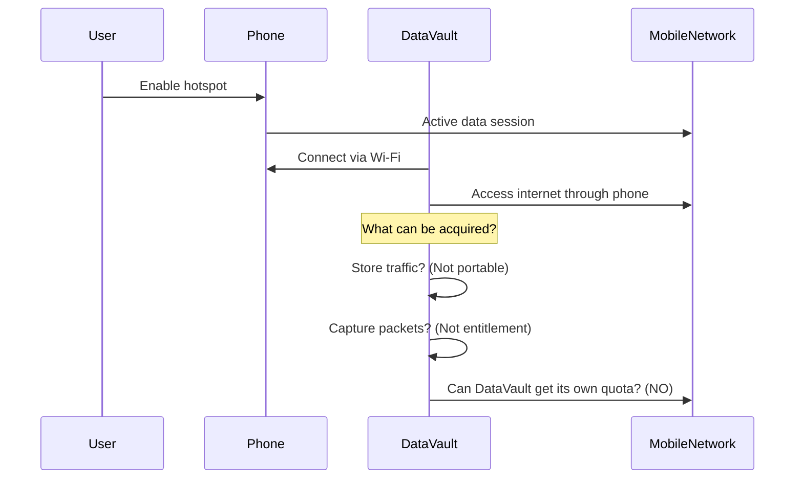

#### 3.1.4 What Can Be Obtained

| Capability | Possible? | Explanation |
|---|---|---|
| Download files to local storage | YES | Standard internet access |
| Cache content for offline access | YES | Local caching |
| Capture and replay packets | YES (but useless) | Packet replay doesn't recreate entitlement |
| Acquire quota entitlement | NO | No mechanism to separate quota from phone's subscription |
| Portable redemption without phone | NO | DataVault has no independent network subscription |

#### 3.1.5 Hardware Requirements
- Wi-Fi client module
- Local storage
- (No cellular modem required for this architecture)

#### 3.1.6 Software Requirements
- Wi-Fi connection management
- Local caching/proxy (if desired)
- (No charging integration required)

#### 3.1.7 Operator Dependencies
- None (uses standard internet access)

#### 3.1.8 Advantages
- Simple to implement
- No operator integration required
- Works with any existing phone hotspot

#### 3.1.9 Limitations
- **DOES NOT ACHIEVE OBJECTIVE**
- Cannot acquire portable data entitlement
- Requires phone hotspot to remain active
- No independent network attachment
- Quota remains tied to phone's subscription

#### 3.1.10 Implementation Complexity
- LOW

#### 3.1.11 Ability to Achieve Objective
- **NO** - This is essentially a Wi-Fi range extender or local cache, not a portable data entitlement system

---

### 3.2 Architecture 2: Operator-Integrated DataVault

#### 3.2.1 Description
DataVault integrates with operator via custom API to request quota transfer from subscriber account, receives entitlement token, and later redeems it through operator's charging system.

#### 3.2.2 Network Topology
```
[Source Phone] --(Mobile Network)--> [Operator CHF]
        |                             |
        |                      [Custom API]
        |                             |
        v                             v
[DataVault Backend] <--------- [Operator API Gateway]
        |
        v
[DataVault Device] --(Mobile Network)--> [Operator CHF for Redemption]
```

#### 3.2.3 Sequence Diagram
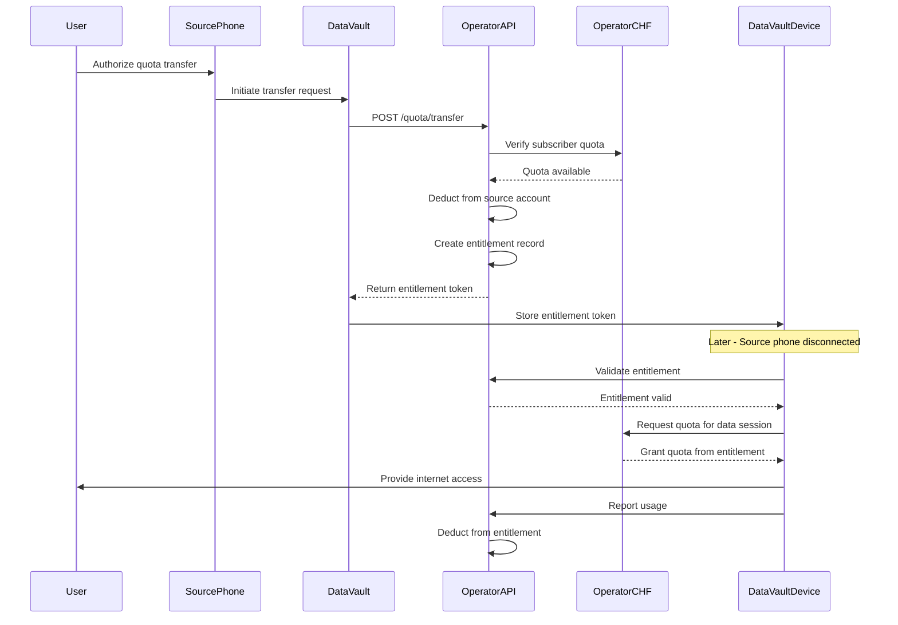

#### 3.2.4 What Can Be Obtained

| Capability | Possible? | Explanation |
|---|---|---|
| Acquire quota from subscriber account | YES (with custom API) | Requires operator to implement new API |
| Portable entitlement token | YES (with custom API) | Cryptographic token issued by operator |
| Independent redemption | YES (with custom API) | Device validates token with operator |
| Usage tracking | YES (with custom API) | Operator deducts from entitlement record |
| Expiry management | YES (with custom API) | Operator enforces expiry in database |

#### 3.2.5 Hardware Requirements
- Cellular modem (4G/5G)
- SIM/eSIM with operator subscription
- Secure element for token storage (optional but recommended)
- Wi-Fi hotspot capability

#### 3.2.6 Software Requirements
- **Custom API client** for operator's quota transfer API
- Token storage and validation logic
- Cellular modem management
- Wi-Fi hotspot management
- Usage tracking and reporting
- Secure boot and tamper resistance

#### 3.2.7 Operator Dependencies
- **CRITICAL:** Operator must implement custom quota transfer API
- Operator must modify CHF or build integration layer
- Operator must provide entitlement database
- Operator must provide authentication/authorization for DataVault
- Operator must provide usage reporting API
- Bilateral commercial agreement required

#### 3.2.8 Security Requirements
- Mutual TLS between DataVault and operator API
- OAuth 2.0 or JWT-based authentication
- Token signature verification (operator signs entitlements)
- Device identity binding (IMEI, serial number, hardware key)
- Replay prevention (nonce, timestamp)
- Audit logging
- Rate limiting

#### 3.2.9 Charging Requirements
- Operator must implement new charging mode: "transferred quota"
- CHF must support device-level quota accounts
- Separate CDR generation for transferred quota usage
- Reconciliation between original subscriber account and device entitlements

#### 3.2.10 Advantages
- **ACHIEVES OBJECTIVE** (with operator cooperation)
- Quota is truly portable
- Independent of source phone after transfer
- Operator maintains charging control
- Potentially scalable across multiple operators

#### 3.2.11 Limitations
- **Requires custom operator API development** (not standard)
- Bilateral agreement required per operator
- Heavy operator dependency
- Operator may see no business case
- Regulatory uncertainty
- Complex security model
- Requires DataVault to have cellular subscription

#### 3.2.12 Implementation Complexity
- **VERY HIGH** (primarily due to operator integration)

#### 3.2.13 Ability to Achieve Objective
- **YES** (conditional on operator implementation)

---

### 3.3 Architecture 3: DataVault as Operator-Authorised Virtual Subscriber

#### 3.3.1 Description
DataVault operates as a virtual subscriber entity with its own IMSI/SUPI that can be funded by transfers from existing subscribers.

#### 3.3.2 Network Topology
```
[Source Subscriber] --(Operator BSS)--> [DataVault Virtual Subscriber]
                                 |
                                 v
                           [Operator CHF]
                                 |
                                 v
[DataVault Device] --(Mobile Network)--> [Operator CHF]
```

#### 3.3.3 Sequence Diagram
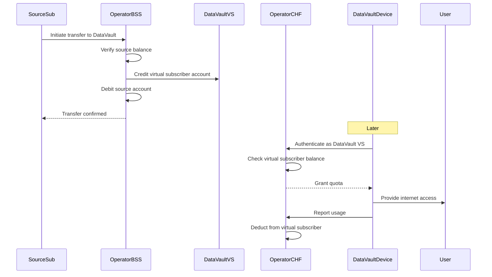

#### 3.3.4 What Can Be Obtained

| Capability | Possible? | Explanation |
|---|---|---|
| Virtual subscriber identity | YES (with operator support) | Operator provisions IMSI/SUPI for DataVault |
| Balance funding by transfers | YES (with custom BSS integration) | Operator implements transfer logic |
| Independent redemption | YES | Device authenticates as virtual subscriber |
| Standard charging integration | YES | Uses normal CHF quota management |
| Portable redemption | YES | Virtual subscriber identity is portable |

#### 3.3.5 Hardware Requirements
- Cellular modem with SIM/eSIM
- DataVault-specific SIM profile (virtual subscriber)
- Wi-Fi hotspot capability

#### 3.3.6 Software Requirements
- Standard cellular modem management
- No custom API required (uses standard charging)
- SIM profile management
- Wi-Fi hotspot management

#### 3.3.7 Operator Dependencies
- **CRITICAL:** Operator must provision virtual subscriber identity
- Operator must implement balance transfer logic in BSS
- Operator must allow DataVault device to authenticate as virtual subscriber
- Bilateral commercial agreement required
- May require regulatory approval for virtual subscriber model

#### 3.3.8 Security Requirements
- SIM/eSIM security (standard)
- Device binding to virtual subscriber identity
- Operator controls all charging and quota
- Standard 3GPP authentication (AKA, 5G AKA)

#### 3.3.9 Charging Requirements
- Uses standard CHF quota management
- Virtual subscriber has normal prepaid account
- Transfer is balance-to-balance, not quota-to-device
- Standard CDR generation

#### 3.3.10 Advantages
- **ACHIEVES OBJECTIVE** (with operator cooperation)
- Leverages standard charging infrastructure
- Simpler API requirements (BSS-level rather than CHF-level)
- Device is a "normal" subscriber from charging perspective
- Potentially easier to integrate than custom CHF API

#### 3.3.11 Limitations
- **Requires operator to provision virtual subscriber**
- Transfer is balance-based, not quota-based (may have tax/fee implications)
- Still requires bilateral agreement
- Virtual subscriber may be treated differently for regulatory purposes
- One device = one virtual subscriber (scaling requires multiple profiles)

#### 3.3.12 Implementation Complexity
- **HIGH** (primarily due to operator BSS integration)

#### 3.3.13 Ability to Achieve Objective
- **YES** (conditional on operator implementation)

---

### 3.4 Architecture 4: DataVault as MVNO or Wholesale Connectivity Platform

#### 3.4.1 Description
DataVault operates as a full MVNO or wholesale customer, receiving bulk data allocation from operator and distributing to individual devices.

#### 3.4.2 Network Topology
```
[Operator Network] --(Wholesale Agreement)--> [DataVault MVNO]
                                                   |
                                                   v
                                         [DataVault CHF/BSS]
                                                   |
             +--------------------------------------+--------------------------------------+
             |                                      |                                      |
             v                                      v                                      v
[DataVault Device 1]                    [DataVault Device 2]                    [DataVault Device N]
```

#### 3.4.3 Sequence Diagram
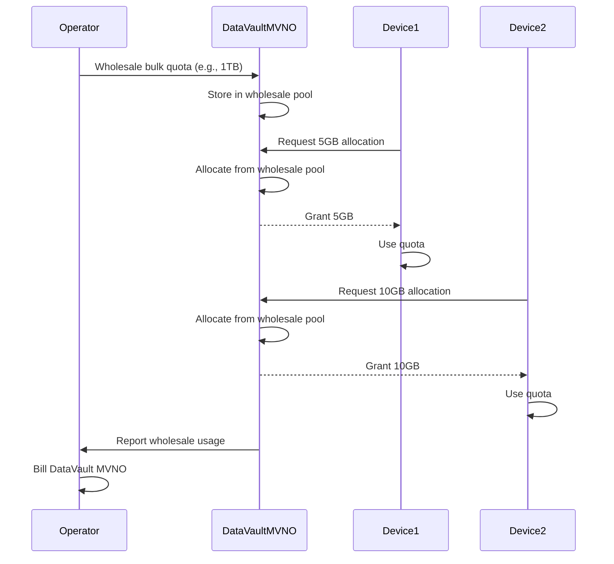

#### 3.4.4 What Can Be Obtained

| Capability | Possible? | Explanation |
|---|---|---|
| Bulk wholesale allocation | YES (with MVNO agreement) | Standard MVNO model |
| Device-level quota distribution | YES (within DataVault) | DataVault manages its own CHF |
| Independent redemption | YES | Devices connect to DataVault's network |
| Portable devices | YES | Devices are DataVault subscribers |
| Source subscriber funding | NO | This is wholesale, not subscriber transfer |

#### 3.4.5 Hardware Requirements
- MVNO infrastructure (servers, CHF, BSS)
- Or integration with MVNE (Mobile Virtual Network Enabler)
- Cellular modems in devices with DataVault SIM profiles
- Wi-Fi hotspot capability

#### 3.4.6 Software Requirements
- Full CHF implementation (or MVNE integration)
- BSS implementation (or MVNE integration)
- Device provisioning system
- Wholesale quota management
- Retail quota distribution
- SIM profile management

#### 3.4.7 Operator Dependencies
- **CRITICAL:** MVNO license and agreement
- Wholesale interconnection
- Network access agreement
- Regulatory approval for MVNO operation
- Significant commercial and legal overhead

#### 3.4.8 Security Requirements
- Full MVNO security model
- Subscriber authentication
- Fraud detection
- Revenue assurance
- Regulatory compliance

#### 3.4.9 Charging Requirements
- Wholesale charging between operator and DataVault
- Retail charging within DataVault (could be zero-rated)
- CDR generation and reconciliation
- Revenue sharing with operator

#### 3.4.10 Advantages
- **ACHIEVES PORTABLE ENTITLEMENT** (but changes model)
- Full control over quota distribution
- Can innovate pricing and features
- Leverages standard MVNO architecture
- Potentially scalable

#### 3.4.11 Limitations
- **DOES NOT ACHIEVE ORIGINAL OBJECTIVE** - This is not subscriber-to-device transfer
- This is wholesale, not the original "transfer from my phone" model
- **Heavy regulatory burden** (MVNO licensing)
- **High capital cost** (MVNO infrastructure)
- **Long timeline** to establish MVNO
- Different business model (DataVault becomes a service provider)

#### 3.4.12 Implementation Complexity
- **EXTREMELY HIGH** (full MVNO setup)

#### 3.4.13 Ability to Achieve Objective
- **NO** - Achieves portable data but through different model (wholesale, not subscriber transfer)

---

### 3.5 Architecture 5: Carrier-Neutral Data Entitlement Platform

#### 3.5.1 Description
DataVault operates as a third-party platform that integrates with multiple operators via APIs, providing a unified entitlement wallet across operators.

#### 3.5.2 Network Topology
```
[Operator A] --(API)--> [DataVault Platform] --(API)--> [Operator B]
       |                     |                       |
       v                     v                       v
[Device on A]          [DataVault Device]      [Device on B]
```

#### 3.5.3 Sequence Diagram
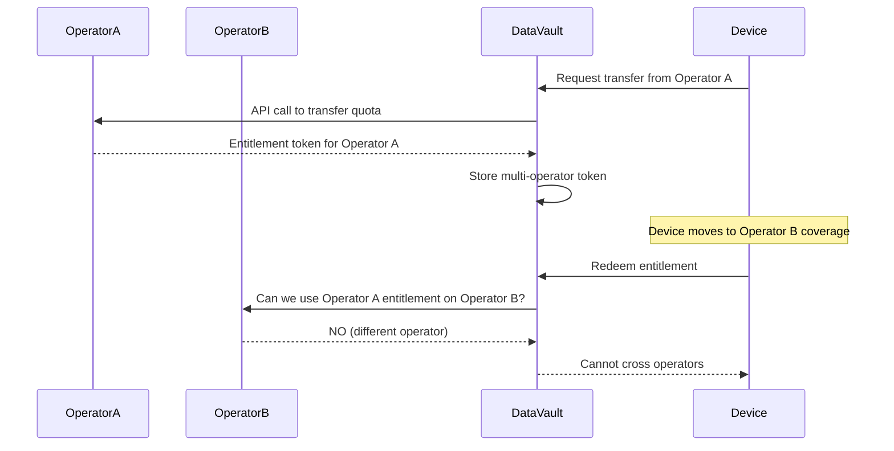

#### 3.5.4 What Can Be Obtained

| Capability | Possible? | Explanation |
|---|---|---|
| Multi-operator integration | YES (with per-operator APIs) | Requires separate integration with each |
| Unified wallet interface | YES | DataVault provides aggregation layer |
| Cross-operator portability | NO | Operators don't share quota |
| Unified redemption | NO | Each operator only accepts its own quota |

#### 3.5.5 Hardware Requirements
- Cellular modem with multi-operator SIM profiles
- Or multiple SIMs
- Wi-Fi hotspot capability

#### 3.5.6 Software Requirements
- Multi-operator API integration
- Token management across operators
- Operator selection logic
- Unified user interface

#### 3.5.7 Operator Dependencies
- **CRITICAL:** API integration with each operator
- Each operator must implement quota transfer API
- Bilateral agreements with each operator
- No clearinghouse or standard exists

#### 3.5.8 Security Requirements
- Multi-operator security models
- Cross-operator token validation
- Unified authentication

#### 3.5.9 Charging Requirements
- Per-operator charging integration
- Reconciliation across operators
- Multi-currency billing

#### 3.5.10 Advantages
- User convenience (single interface)
- Potential for operator arbitrage
- Cross-operator visibility

#### 3.5.11 Limitations
- **Cannot achieve cross-operator quota portability** (fundamental incompatibility)
- Still requires per-operator custom APIs
- Highest integration complexity
- No operator incentive to participate
- Business model unclear

#### 3.5.12 Implementation Complexity
- **EXTREMELY HIGH** (N operator integrations)

#### 3.5.13 Ability to Achieve Objective
- **PARTIAL** - Achieves portability within single operator, not across operators

---

### 3.6 Architecture 6: Independent Local Device with Redemption Gateway

#### 3.6.1 Description
DataVault operates as a local Wi-Fi device that uses a remote operator-authorised redemption server to obtain connectivity while providing local Wi-Fi access.

#### 3.6.2 Network Topology
```
[User Devices] --(Wi-Fi)--> [DataVault] --(Cellular)--> [Mobile Network]
                                                     |
                                                     v
                                              [Operator CHF]
                                                     |
                                                     v
                                           [DataVault Backend]
                                                     |
                                                     v
                                          [Entitlement Database]
```

#### 3.6.3 Sequence Diagram
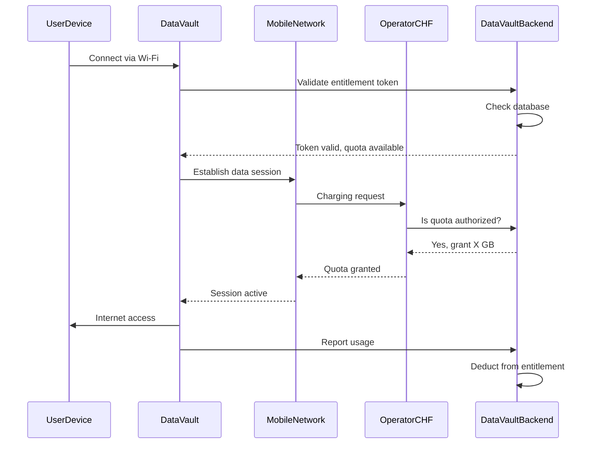

#### 3.6.4 What Can Be Obtained

| Capability | Possible? | Explanation |
|---|---|---|
| Local Wi-Fi access | YES | Standard hotspot |
| Entitlement validation | YES (with backend) | Backend validates token |
| Network connectivity | YES (with operator integration) | Device uses normal cellular connection |
| Quota enforcement | YES (hybrid) | Backend deducts, operator may also enforce |
| Portable redemption | YES | Device moves with entitlement |

#### 3.6.5 Hardware Requirements
- Cellular modem
- SIM/eSIM with operator subscription
- Wi-Fi hotspot capability
- Local storage for token

#### 3.6.6 Software Requirements
- Cellular modem management
- Wi-Fi hotspot management
- Backend API client
- Token storage and validation
- Usage tracking
- Hybrid quota enforcement (local + operator)

#### 3.6.7 Operator Dependencies
- **MODERATE:** Operator must authorize DataVault backend to validate entitlements
- Operator must accept DataVault backend as quota authority
- Or operator provides validation API that DataVault calls
- Bilateral agreement required

#### 3.6.8 Security Requirements
- Secure communication between device and backend
- Token signature verification
- Device identity binding
- Mutual TLS with operator (if operator integration)
- Replay prevention

#### 3.6.9 Charging Requirements
- Either:
  - Operator trusts DataVault backend for quota enforcement
  - Or operator provides validation API
  - Or hybrid model with reconciliation

#### 3.6.10 Advantages
- **ACHIEVES OBJECTIVE** (with operator cooperation)
- Local device can operate independently
- Backend provides centralized management
- Potentially simpler than full CHF integration
- Can work with offline validation (if tokens allow)

#### 3.6.11 Limitations
- Still requires operator integration
- Backend becomes single point of failure
- Network connectivity required for validation (unless offline-capable tokens)
- Reconciliation complexity
- Operator may resist giving quota authority to third party

#### 3.6.12 Implementation Complexity
- **HIGH** (backend + device + operator integration)

#### 3.6.13 Ability to Achieve Objective
- **YES** (conditional on operator cooperation)

---

### 3.7 Architecture Comparison Summary

| Architecture | Achieves Objective? | Operator Dependency | Implementation Complexity | Regulatory Burden | Recommended? |
|---|---|---|---|---|---|
| 1: Standard Hotspot | NO | None | LOW | None | NO |
| 2: Operator-Integrated | YES (conditional) | CRITICAL - Custom API | VERY HIGH | Uncertain | MAYBE |
| 3: Virtual Subscriber | YES (conditional) | CRITICAL - BSS integration | HIGH | Moderate | MAYBE |
| 4: MVNO/Wholesale | NO (different model) | CRITICAL - MVNO agreement | EXTREMELY HIGH | VERY HIGH | NO |
| 5: Carrier-Neutral | PARTIAL (single-operator) | CRITICAL - Multiple APIs | EXTREMELY HIGH | Uncertain | NO |
| 6: Redemption Gateway | YES (conditional) | MODERATE - Validation | HIGH | Moderate | YES |

---

## PART IV - PROPOSED END-TO-END ARCHITECTURE

Based on the analysis, Architecture 6 (Independent Local Device with Redemption Gateway) combined with elements of Architecture 2 (Operator-Integrated) offers the most viable path forward.

### 4.1 Recommended Architecture: Hybrid Operator-Backed Model

#### 4.1.1 Concept

DataVault operates as a local Wi-Fi device with its own cellular modem and SIM. It uses a custom operator API to:
1. Acquire quota from a source subscriber's account
2. Receive a cryptographically signed entitlement token
3. Validate the token with the operator's backend
4. Redeem quota through its own cellular subscription

The operator maintains charging control throughout, but extends its system to support the new "transferred quota" model.

#### 4.1.2 Network Topology

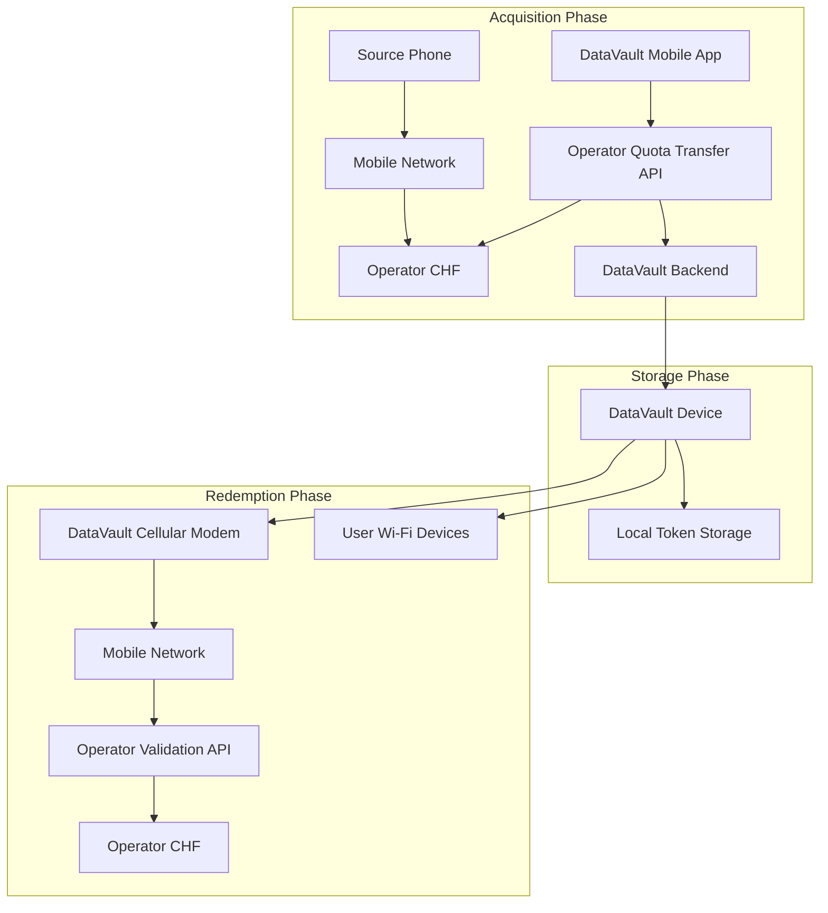

#### 4.1.3 Detailed Sequence Diagram

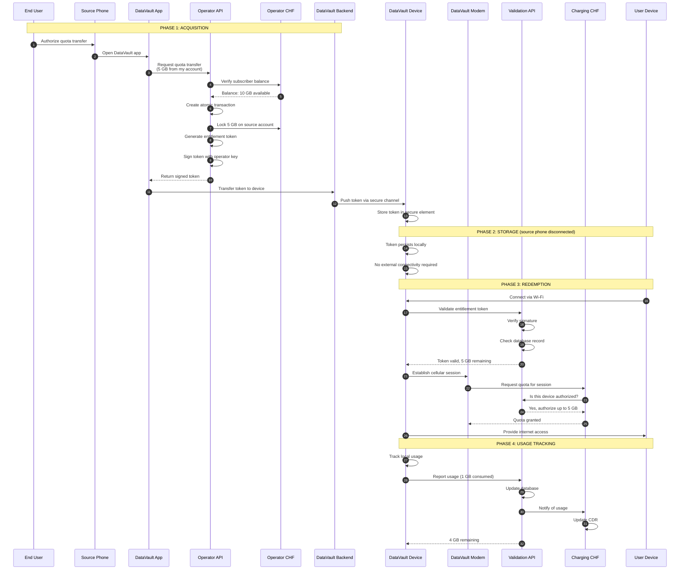

#### 4.1.4 Data Model

```yaml
Entitlement:
  entitlement_id: UUID
  source_subscriber_id: string  # Original subscriber
  destination_device_id: string  # DataVault device ID
  allocated_volume: integer  # bytes
  remaining_volume: integer  # bytes
  issued_at: timestamp
  expires_at: timestamp
  status: enum (ACTIVE, EXHAUSTED, EXPIRED, REVOKED)
  transfer_mode: enum (TRANSFER, DELEGATE)
  operator_signature: JWT
  device_binding: object  # IMEI, serial, hardware key

UsageReport:
  report_id: UUID
  entitlement_id: UUID
  device_id: string
  volume_consumed: integer
  reported_at: timestamp
  session_id: string
  cell_id: string  # For location tracking

TransferAudit:
  audit_id: UUID
  entitlement_id: UUID
  source_subscriber_id: string
  destination_device_id: string
  volume_transferred: integer
  transfer_timestamp: timestamp
  initiated_by: string  # App user ID
  approval_method: enum (APP, USSD, WEB)
```

#### 4.1.5 API Specification

**POST /api/v1/quota/transfer**
```json
{
  "source_subscriber": "254712345678",
  "destination_device_id": "DV-001-ABCD",
  "volume": 5368709120,
  "expiry": "2026-12-31T23:59:59Z",
  "transfer_mode": "TRANSFER",
  "authorization": "Bearer <subscriber_token>"
}
```

Response:
```json
{
  "entitlement_id": "550e8400-e29b-41d4-a716-446655440000",
  "allocated_volume": 5368709120,
  "remaining_volume": 5368709120,
  "issued_at": "2026-11-04T10:00:00Z",
  "expires_at": "2026-12-31T23:59:59Z",
  "token": "eyJhbGciOiJSUzI1NiIsInR5cCI6IkpXVCJ9...",
  "status": "ACTIVE"
}
```

**POST /api/v1/entitlement/validate**
```json
{
  "entitlement_id": "550e8400-e29b-41d4-a716-446655440000",
  "device_id": "DV-001-ABCD",
  "token": "eyJhbGciOiJSUzI1NiIsInR5cCI6IkpXVCJ9..."
}
```

Response:
```json
{
  "valid": true,
  "remaining_volume": 5368709120,
  "expires_at": "2026-12-31T23:59:59Z",
  "status": "ACTIVE"
}
```

**POST /api/v1/entitlement/report-usage**
```json
{
  "entitlement_id": "550e8400-e29b-41d4-a716-446655440000",
  "device_id": "DV-001-ABCD",
  "volume_consumed": 1073741824,
  "session_id": "sess-12345",
  "reported_at": "2026-11-04T15:30:00Z"
}
```

Response:
```json
{
  "remaining_volume": 4294967296,
  "transaction_id": "txn-67890",
  "status": "ACTIVE"
}
```

#### 4.1.6 State Machine

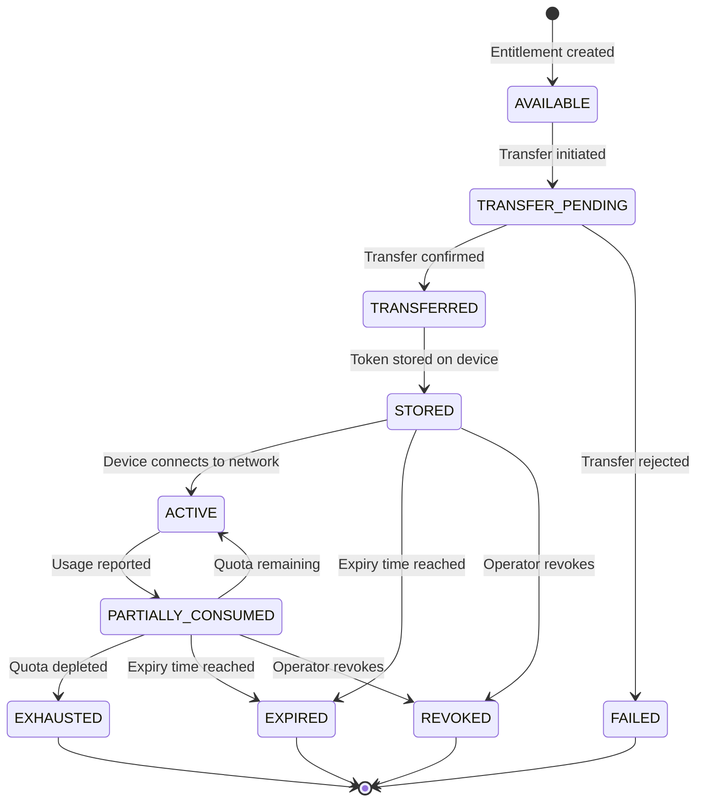

**State Definitions:**

- **AVAILABLE**: Entitlement can be created (not yet allocated)
- **TRANSFER_PENDING**: Transfer request submitted, awaiting confirmation
- **TRANSFERRED**: Transfer confirmed, quota deducted from source
- **FAILED**: Transfer failed (insufficient quota, subscriber declined, etc.)
- **STORED**: Token stored on device, awaiting redemption
- **ACTIVE**: Device is actively using quota
- **PARTIALLY_CONSUMED**: Some quota used, remainder available
- **EXHAUSTED**: All quota consumed
- **EXPIRED**: Entitlement expired before full consumption
- **REVOKED**: Operator revoked entitlement (fraud, policy violation)

**Valid Transitions:**

```
AVAILABLE → TRANSFER_PENDING → TRANSFERRED → STORED → ACTIVE
ACTIVE ↔ PARTIALLY_CONSUMED (loop until exhaustion or expiry)
PARTIALLY_CONSUMED → EXHAUSTED | EXPIRED | REVOKED
STORED → EXPIRED | REVOKED
TRANSFER_PENDING → FAILED
```

#### 4.1.7 Consistency Mechanisms

**Idempotency:**
- All API operations include idempotency keys
- Duplicate requests with same key return cached response
- Prevents double-spending on network retry

**Transaction Rollback:**
- Quota transfer uses database transaction
- If any step fails, entire transaction rolls back
- Source account quota is restored

**Distributed Locking:**
- Usage reporting uses optimistic locking
- Concurrent updates detect version conflicts
- Last write wins with version check

**Event Sourcing:**
- All state changes recorded as immutable events
- Event log enables audit trail and replay
- Can reconstruct state from event history

**Recovery After Network Failure:**
- Device stores usage locally when offline
- Batch sync when connectivity restored
- Backend processes reports in order
- Reconciliation identifies discrepancies

#### 4.1.8 Hardware Requirements

**DataVault Device:**
- 4G/5G cellular modem (Quectel, Sierra Wireless, or similar)
- eSIM support (GSMA SGP.22 compliant)
- Secure element or TPM for token storage
- ARM or x86 processor (Raspberry Pi 5, mini-PC)
- Wi-Fi 802.11ac/ax hotspot
- 8GB+ RAM, 64GB+ storage
- Battery backup (optional for portability)

**DataVault Backend:**
- Cloud infrastructure (AWS, Azure, or local data center)
- PostgreSQL database
- Redis for caching
- Load balancer
- Application servers (Python FastAPI or similar)

#### 4.1.9 Software Requirements

**DataVault Device Software:**
- Linux (OpenWrt or embedded Linux)
- Cellular modem management (ModemManager, qmicli)
- eSIM profile management (LPA)
- Token storage and validation
- Wi-Fi hotspot management (hostapd)
- Usage tracking (nftables, iptables)
- Secure boot (dm-verity, UEFI Secure Boot)
- Hardware key integration

**DataVault Backend Software:**
- Python FastAPI or Go
- PostgreSQL
- Redis
- Mutual TLS
- OAuth 2.0 / JWT
- Audit logging
- Monitoring (Prometheus, Grafana)

**Operator Integration:**
- Custom API client library
- Mutual TLS certificates
- OAuth 2.0 client credentials
- Token validation logic
- Usage reporting client

#### 4.1.10 Security Architecture

See Part V for detailed cybersecurity analysis.

#### 4.1.11 Operator Dependencies

**Critical Path:**
1. Operator must implement Quota Transfer API
2. Operator must implement Validation API
3. Operator must modify CHF or add integration layer
4. Operator must provide entitlement database
5. Operator must provide authentication for DataVault
6. Bilateral commercial agreement required

**Timeline Estimate:**
- API specification: 1-2 months
- API development: 3-6 months
- CHF integration: 3-6 months
- Testing: 2-3 months
- **Total: 9-17 months per operator**

#### 4.1.12 Advantages

- **ACHIEVES OBJECTIVE** with realistic operator cooperation
- Operator maintains charging control
- Quota is truly portable
- Independent of source phone after transfer
- Leverages existing cellular infrastructure
- Potentially scalable across operators
- Uses standard security mechanisms (mutual TLS, OAuth 2.0)

#### 4.1.13 Limitations

- **Requires custom operator API** (not standard)
- Bilateral agreement required per operator
- Heavy operator dependency
- 9-17 month integration timeline per operator
- Operator may see no business case
- Regulatory uncertainty
- Requires DataVault device to have cellular subscription

#### 4.1.14 Implementation Complexity

- **HIGH** (but feasible with operator cooperation)

#### 4.1.15 Ability to Achieve Objective

- **YES** (conditional on operator implementation)

---

## PART V - DATAVAULT ENTITLEMENT ENGINE DESIGN

### 5.1 System Architecture

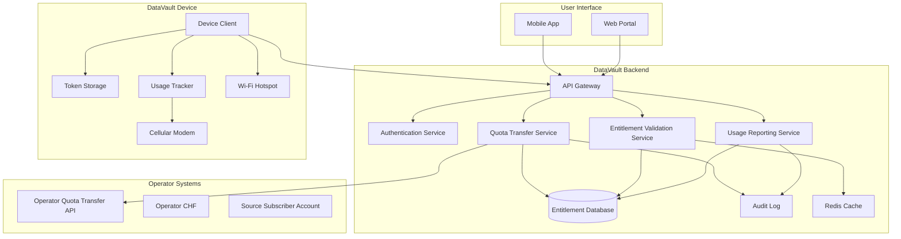

### 5.2 Entitlement Engine Components

#### 5.2.1 Quota Transfer Service

**Responsibilities:**
- Process quota transfer requests
- Authenticate source subscriber
- Verify available quota
- Create atomic transfer transaction
- Generate entitlement token
- Sign token with operator key
- Record transfer in audit log

**Key Methods:**
```python
class QuotaTransferService:
    async def initiate_transfer(
        self,
        source_subscriber_id: str,
        destination_device_id: str,
        volume: int,
        expiry: datetime,
        transfer_mode: TransferMode
    ) -> TransferResult

    async def confirm_transfer(
        self,
        transfer_id: str,
        authorization: str
    ) -> Entitlement

    async def cancel_transfer(
        self,
        transfer_id: str
    ) -> None

    async def generate_entitlement_token(
        self,
        entitlement: Entitlement
    ) -> JWT
```

#### 5.2.2 Entitlement Validation Service

**Responsibilities:**
- Validate entitlement tokens
- Check device binding
- Verify token signature
- Check expiry and status
- Return remaining quota
- Support offline validation (if applicable)

**Key Methods:**
```python
class EntitlementValidationService:
    async def validate_token(
        self,
        token: JWT,
        device_id: str
    ) -> ValidationResult

    async def check_quota(
        self,
        entitlement_id: str,
        requested_volume: int
    ) -> QuotaCheckResult

    async def verify_device_binding(
        self,
        entitlement_id: str,
        device_id: str
    ) -> bool

    async def revoke_entitlement(
        self,
        entitlement_id: str,
        reason: str
    ) -> None
```

#### 5.2.3 Usage Reporting Service

**Responsibilities:**
- Receive usage reports from devices
- Deduct from remaining quota
- Update database atomically
- Detect quota exhaustion
- Trigger notifications
- Handle concurrent reports

**Key Methods:**
```python
class UsageReportingService:
    async def report_usage(
        self,
        entitlement_id: str,
        device_id: str,
        volume_consumed: int,
        session_id: str
    ) -> UsageReportResult

    async def batch_report_usage(
        self,
        reports: List[UsageReport]
    ) -> BatchReportResult

    async def reconcile_usage(
        self,
        entitlement_id: str
    ) -> ReconciliationResult
```

#### 5.2.4 Fraud Detection Service

**Responsibilities:**
- Detect anomalous usage patterns
- Identify potential replay attacks
- Flag suspicious transfers
- Monitor for token duplication
- Rate limiting

**Key Methods:**
```python
class FraudDetectionService:
    async def check_transfer_anomaly(
        self,
        source_subscriber_id: str,
        destination_device_id: str,
        volume: int
    ) -> AnomalyCheckResult

    async def detect_replay_attack(
        self,
        token: JWT
    ) -> ReplayCheckResult

    async def monitor_usage_pattern(
        self,
        entitlement_id: str,
        usage_reports: List[UsageReport]
    ) -> PatternAnalysisResult
```

### 5.3 Database Schema

```sql
-- Entitlements table
CREATE TABLE entitlements (
    entitlement_id UUID PRIMARY KEY DEFAULT gen_random_uuid(),
    source_subscriber_id VARCHAR(255) NOT NULL,
    destination_device_id VARCHAR(255) NOT NULL,
    allocated_volume BIGINT NOT NULL,
    remaining_volume BIGINT NOT NULL,
    issued_at TIMESTAMP WITH TIME ZONE NOT NULL DEFAULT NOW(),
    expires_at TIMESTAMP WITH TIME ZONE NOT NULL,
    status VARCHAR(50) NOT NULL DEFAULT 'ACTIVE',
    transfer_mode VARCHAR(50) NOT NULL,
    token_signature TEXT NOT NULL,
    device_binding JSONB NOT NULL,
    version INTEGER NOT NULL DEFAULT 1,
    created_at TIMESTAMP WITH TIME ZONE NOT NULL DEFAULT NOW(),
    updated_at TIMESTAMP WITH TIME ZONE NOT NULL DEFAULT NOW(),
    CONSTRAINT non_negative_remaining CHECK (remaining_volume >= 0),
    CONSTRAINT valid_status CHECK (status IN ('ACTIVE', 'EXHAUSTED', 'EXPIRED', 'REVOKED', 'TRANSFER_PENDING', 'STORED', 'PARTIALLY_CONSUMED'))
);

CREATE INDEX idx_entitlements_device ON entitlements(destination_device_id);
CREATE INDEX idx_entitlements_subscriber ON entitlements(source_subscriber_id);
CREATE INDEX idx_entitlements_status ON entitlements(status);
CREATE INDEX idx_entitlements_expires ON entitlements(expires_at);

-- Usage reports table
CREATE TABLE usage_reports (
    report_id UUID PRIMARY KEY DEFAULT gen_random_uuid(),
    entitlement_id UUID NOT NULL,
    device_id VARCHAR(255) NOT NULL,
    volume_consumed BIGINT NOT NULL,
    reported_at TIMESTAMP WITH TIME ZONE NOT NULL,
    session_id VARCHAR(255),
    cell_id VARCHAR(255),
    location_lat DECIMAL(10, 8),
    location_lon DECIMAL(11, 8),
    created_at TIMESTAMP WITH TIME ZONE NOT NULL DEFAULT NOW(),
    CONSTRAINT fk_entitlement FOREIGN KEY (entitlement_id) REFERENCES entitlements(entitlement_id)
);

CREATE INDEX idx_usage_reports_entitlement ON usage_reports(entitlement_id);
CREATE INDEX idx_usage_reports_device ON usage_reports(device_id);
CREATE INDEX idx_usage_reports_session ON usage_reports(session_id);

-- Transfer audit log
CREATE TABLE transfer_audit_log (
    log_id UUID PRIMARY KEY DEFAULT gen_random_uuid(),
    entitlement_id UUID NOT NULL,
    source_subscriber_id VARCHAR(255) NOT NULL,
    destination_device_id VARCHAR(255) NOT NULL,
    volume_transferred BIGINT NOT NULL,
    transfer_timestamp TIMESTAMP WITH TIME ZONE NOT NULL,
    initiated_by VARCHAR(255) NOT NULL,
    approval_method VARCHAR(50) NOT NULL,
    ip_address INET,
    user_agent TEXT,
    created_at TIMESTAMP WITH TIME ZONE NOT NULL DEFAULT NOW(),
    CONSTRAINT fk_entitlement_audit FOREIGN KEY (entitlement_id) REFERENCES entitlements(entitlement_id)
);

CREATE INDEX idx_audit_log_entitlement ON transfer_audit_log(entitlement_id);
CREATE INDEX idx_audit_log_subscriber ON transfer_audit_log(source_subscriber_id);
CREATE INDEX idx_audit_log_timestamp ON transfer_audit_log(transfer_timestamp);

-- Device registrations
CREATE TABLE device_registrations (
    device_id VARCHAR(255) PRIMARY KEY,
    imei VARCHAR(50) UNIQUE,
    serial_number VARCHAR(255),
    hardware_public_key TEXT,
    registered_at TIMESTAMP WITH TIME ZONE NOT NULL DEFAULT NOW(),
    last_seen TIMESTAMP WITH TIME ZONE,
    status VARCHAR(50) NOT NULL DEFAULT 'ACTIVE'
);

-- Subscriber authorizations
CREATE TABLE subscriber_authorizations (
    auth_id UUID PRIMARY KEY DEFAULT gen_random_uuid(),
    subscriber_id VARCHAR(255) NOT NULL,
    authorized_device_id VARCHAR(255) NOT NULL,
    authorized_at TIMESTAMP WITH TIME ZONE NOT NULL DEFAULT NOW(),
    expires_at TIMESTAMP WITH TIME ZONE,
    created_at TIMESTAMP WITH TIME ZONE NOT NULL DEFAULT NOW(),
    CONSTRAINT fk_device FOREIGN KEY (authorized_device_id) REFERENCES device_registrations(device_id)
);
```

### 5.4 API Specification

#### 5.4.1 OpenAPI Specification (excerpt)

```yaml
openapi: 3.0.0
info:
  title: DataVault Entitlement API
  version: 1.0.0
  description: API for quota transfer and entitlement management

servers:
  - url: https://api.datavault.example.com/v1

paths:
  /quota/transfer:
    post:
      summary: Transfer quota from subscriber to device
      requestBody:
        required: true
        content:
          application/json:
            schema:
              $ref: '#/components/schemas/TransferRequest'
      responses:
        '200':
          description: Transfer successful
          content:
            application/json:
              schema:
                $ref: '#/components/schemas/Entitlement'
        '400':
          description: Invalid request
        '401':
          description: Unauthorized
        '403':
          description: Insufficient quota
        '409':
          description: Device already has active entitlement

  /entitlement/{entitlement_id}/validate:
    post:
      summary: Validate entitlement token
      parameters:
        - name: entitlement_id
          in: path
          required: true
          schema:
            type: string
            format: uuid
      requestBody:
        required: true
        content:
          application/json:
            schema:
              $ref: '#/components/schemas/ValidationRequest'
      responses:
        '200':
          description: Validation successful
          content:
            application/json:
              schema:
                $ref: '#/components/schemas/ValidationResult'

  /entitlement/{entitlement_id}/report-usage:
    post:
      summary: Report usage for entitlement
      parameters:
        - name: entitlement_id
          in: path
          required: true
          schema:
            type: string
            format: uuid
      requestBody:
        required: true
        content:
          application/json:
            schema:
              $ref: '#/components/schemas/UsageReport'
      responses:
        '200':
          description: Usage recorded
          content:
            application/json:
              schema:
                $ref: '#/components/schemas/UsageReportResult'

components:
  schemas:
    TransferRequest:
      type: object
      required:
        - source_subscriber
        - destination_device_id
        - volume
        - expiry
        - transfer_mode
      properties:
        source_subscriber:
          type: string
          description: Subscriber identifier (MSISDN or IMPI)
        destination_device_id:
          type: string
          description: DataVault device identifier
        volume:
          type: integer
          description: Volume to transfer in bytes
        expiry:
          type: string
          format: date-time
          description: Entitlement expiry time
        transfer_mode:
          type: string
          enum: [TRANSFER, DELEGATE]
          description: Transfer mode

    Entitlement:
      type: object
      properties:
        entitlement_id:
          type: string
          format: uuid
        allocated_volume:
          type: integer
        remaining_volume:
          type: integer
        issued_at:
          type: string
          format: date-time
        expires_at:
          type: string
          format: date-time
        token:
          type: string
          description: JWT token
        status:
          type: string
          enum: [ACTIVE, EXHAUSTED, EXPIRED, REVOKED]

    ValidationRequest:
      type: object
      required:
        - device_id
        - token
      properties:
        device_id:
          type: string
        token:
          type: string
          description: JWT token

    ValidationResult:
      type: object
      properties:
        valid:
          type: boolean
        remaining_volume:
          type: integer
        expires_at:
          type: string
          format: date-time
        status:
          type: string

    UsageReport:
      type: object
      required:
        - device_id
        - volume_consumed
        - session_id
      properties:
        device_id:
          type: string
        volume_consumed:
          type: integer
        session_id:
          type: string
        reported_at:
          type: string
          format: date-time

    UsageReportResult:
      type: object
      properties:
        remaining_volume:
          type: integer
        transaction_id:
          type: string
        status:
          type: string
```

### 5.5 Error Handling

**Error Codes:**
- `INSUFFICIENT_QUOTA`: Source subscriber doesn't have enough quota
- `DEVICE_NOT_REGISTERED`: Destination device not registered
- `DEVICE_ALREADY_HAS_ENTITLEMENT`: Device already has active entitlement
- `TOKEN_INVALID`: Token signature verification failed
- `TOKEN_EXPIRED`: Token has expired
- `DEVICE_MISMATCH`: Token not bound to this device
- `QUOTA_EXHAUSTED`: Entitlement quota exhausted
- `REPLAY_ATTACK`: Token has been used before
- `RATE_LIMIT_EXCEEDED`: Too many requests
- `NETWORK_ERROR`: Temporary network failure

**Retry Strategy:**
- Idempotent operations support safe retry
- Exponential backoff for transient errors
- Circuit breaker for operator API failures
- Dead letter queue for failed operations

---

## PART VI - CYBERSECURITY ARCHITECTURE

### 6.1 Threat Model (STRIDE Analysis)

| Threat | Description | Impact | Mitigation |
|---|---|---|---|
| **S**poofing | Attacker impersonates legitimate device or subscriber | Unauthorized quota transfer, quota theft | Mutual TLS, device certificates, hardware binding |
| **T**ampering | Attacker modifies entitlement token or usage reports | Quota manipulation, double-spending | Cryptographic signatures, audit logs, database constraints |
| **R**epudiation | Subscriber denies authorizing transfer | Disputes, revenue loss | Non-repudiation via digital signatures, audit trail |
| **I**nformation Disclosure | Attacker accesses subscriber data or entitlement details | Privacy violation, quota exposure | Encryption at rest and in transit, access controls |
| **D**enial of Service | Attacker overwhelms API or device | Service unavailability | Rate limiting, caching, DDoS protection |
| **E**levation of Privilege | Attacker gains unauthorized access | System compromise | Principle of least privilege, role-based access control |

### 6.2 Attack Trees

#### 6.2.1 Attack Tree: Duplicate Entitlement Redemption

```
GOAL: Redeem same entitlement twice
|
+-- Attacker copies token to another device
|   |
|   +-- Mitigation: Device binding check
|   +-- Mitigation: Hardware key verification
|
+-- Attacker replays token on same device
|   |
|   +-- Mitigation: Token one-time use flag
|   +-- Mitigation: Nonce in token
|
+-- Attacker modifies token to extend quota
|   |
|   +-- Mitigation: Operator signature verification
|   +-- Mitigation: Token immutability
|
+-- Attacker intercepts and delays usage report
    |
    +-- Mitigation: Session timeout
    +-- Mitigation: Operator-side quota enforcement
```

#### 6.2.2 Attack Tree: Impersonate Subscriber

```
GOAL: Transfer quota without subscriber authorization
|
+-- Attacker steals subscriber credentials
|   |
|   +-- Mitigation: Multi-factor authentication
|   +-- Mitigation: Transaction confirmation (SMS, app)
|
+-- Attacker compromises subscriber device
|   |
|   +-- Mitigation: App certificate pinning
|   +-- Mitigation: Device attestation
|
+-- Attacker performs session hijacking
    |
    +-- Mitigation: Short-lived tokens
    +-- Mitigation: TLS with perfect forward secrecy
```

#### 6.2.3 Attack Tree: Manipulate Usage Counters

```
GOAL: Report less usage than actual
|
+-- Attacker modifies device software
|   |
|   +-- Mitigation: Secure boot
|   +-- Mitigation: Code signing
|   +-- Mitigation: Hardware-backed counters
|
+-- Attacker intercepts traffic to usage tracker
|   |
|   +-- Mitigation: Kernel-level monitoring
|   +-- Mitigation: Encrypted internal communication
|
+-- Attacker modifies packets before they reach counter
    |
    +-- Mitigation: Deep packet inspection
    +-- Mitigation: Operator-side verification
```

### 6.3 Security Controls

#### 6.3.1 Authentication

**Subscriber Authentication:**
- OAuth 2.0 authorization code flow with PKCE
- Multi-factor authentication (SMS, app push, biometric)
- Short-lived access tokens (5-15 minutes)
- Refresh tokens with rotation

**Device Authentication:**
- Mutual TLS with device certificates
- Hardware key (TPM, secure element)
- Device attestation (Android SafetyNet, Apple DeviceCheck)
- IMEI binding

**API Authentication:**
- OAuth 2.0 client credentials for machine-to-machine
- Mutual TLS between DataVault and operator
- API keys with rate limiting
- IP whitelisting (where applicable)

#### 6.3.2 Authorization

**Subscriber Authorization:**
- User must explicitly authorize each transfer
- Optional: Pre-authorized device list
- Transfer limits (max per day, max per month)
- Cooling-off period for large transfers

**Device Authorization:**
- Device can only redeem entitlements bound to it
- Device cannot transfer entitlements to other devices
- Device registration required before first use

**API Authorization:**
- Role-based access control (RBAC)
- Scope-based authorization (OAuth 2.0 scopes)
- Principle of least privilege
- Regular access review

#### 6.3.3 Data Protection

**Encryption:**
- TLS 1.3 for all network communication
- AES-256-GCM for data at rest
- Hardware security module (HSM) for key storage
- Key rotation policy (90 days)

**Token Security:**
- JWT signed with RS256 or ES256
- Operator private key stored in HSM
- Token expiry (configurable, default 30 days)
- Token includes: entitlement_id, device_id, volume, expiry, nonce

**Device Security:**
- Secure boot (dm-verity, UEFI Secure Boot)
- Encrypted storage (LUKS, BitLocker)
- Code signing for device firmware
- Regular security updates

#### 6.3.4 Audit and Monitoring

**Audit Logging:**
- All quota transfers logged
- All entitlement validations logged
- All usage reports logged
- All administrative actions logged
- Logs immutable (append-only, WORM storage)

**Monitoring:**
- Real-time anomaly detection
- Rate limit monitoring
- Failed authentication attempts
- Unusual usage patterns
- API latency and error rates

**Alerting:**
- Automated alerts for security events
- Escalation procedures
- 24/7 security operations center (SOC)
- Incident response plan

#### 6.3.5 Fraud Prevention

**Transfer Limits:**
- Maximum transfer per transaction (e.g., 10 GB)
- Maximum transfers per day (e.g., 3)
- Maximum transfers per month (e.g., 20 GB)
- Cooling-off period after rejection

**Usage Monitoring:**
- Detect unrealistic usage patterns
- Flag unusually high consumption rates
- Compare usage against expected patterns
- Detect concurrent usage from multiple locations

**Device Monitoring:**
- Track device reputation
- Flag devices with suspicious behavior
- Block devices that violate policies
- Require re-registration for compromised devices

### 6.4 Compliance Considerations

**Kenya Data Protection Act (2019):**
- Register as data controller/processor with ODPC
- Implement data subject rights (access, correction, deletion)
- Data breach notification within 72 hours
- Privacy by design and by default

**Communications Authority Regulations:**
- Compliance with licensing requirements
- Network security standards
- Interconnection security
- Consumer protection regulations

**International Standards:**
- ISO 27001 (Information Security Management)
- ISO 27701 (Privacy Information Management)
- PCI DSS (if payment data involved)
- SOC 2 Type II (for operator trust)

---

## PART VII - KENYAN OPERATOR ENGAGEMENT STRATEGY

### 7.1 Target Operators

#### 7.1.1 Safaricom PLC

**Market Position:**
- Largest MNO in Kenya (~65% market share)
- Advanced 4G/5G network
- Established API ecosystem (Daraja 3.0)
- Strong innovation culture

**Relevant Departments:**
- Enterprise Business Unit
- Digital Services
- Technology and Innovation
- Network Engineering
- IT and Systems
- Legal and Regulatory
- Commercial and Consumer Business

**API Experience:**
- Daraja 3.0 platform for M-PESA APIs
- Experience with third-party developer partnerships
- Established onboarding and support processes

**Engagement Approach:**
1. **Initial Contact:** Technology and Innovation Department
2. **Value Proposition:** New revenue stream from data transfer fees
3. **Technical Presentation:** Demonstrate compatibility with existing infrastructure
4. **Pilot Proposal:** Limited trial with controlled user group
5. **Commercial Agreement:** Revenue sharing model

#### 7.1.2 Airtel Kenya

**Market Position:**
- Second-largest MNO (~25% market share)
- Growing 4G network
- Airtel Africa Developer Portal
- Focus on digital services

**Relevant Departments:**
- Digital Services
- IT and Networks
- Commercial Operations
- Enterprise Business
- Legal and Regulatory

**API Experience:**
- Airtel Africa Developer Portal
- Mobile money APIs
- Experience with pan-African API standardization

**Engagement Approach:**
1. **Initial Contact:** Digital Services Department
2. **Value Proposition:** Differentiation through innovative service
3. **Regional Alignment:** Leverage Airtel Africa's regional presence
4. **Pilot Proposal:** Collaborate with other Airtel markets
5. **Commercial Agreement:** Revenue sharing + cross-border potential

#### 7.1.3 Telkom Kenya

**Market Position:**
- Third-largest MNO (~5% market share)
- Focused on data services
- Competitive pricing
- Seeking differentiation

**Relevant Departments:**
- Commercial
- Technology
- Networks
- Legal

**API Experience:**
- Less mature API ecosystem
- Opportunity to be first-mover
- More flexible partnership terms

**Engagement Approach:**
1. **Initial Contact:** Commercial or Technology Department
2. **Value Proposition:** Competitive differentiation, customer acquisition
3. **Technical Assistance:** Offer to help build API capability
4. **Pilot Proposal:** Early adopter benefits
5. **Commercial Agreement:** Favorable terms for early partnership

### 7.2 Operator Partnership Proposal

#### 7.2.1 Executive Summary

**What DataVault Does:**
DataVault is a portable internet gateway that allows subscribers to transfer mobile data quota from their phone to a dedicated device, which can then provide Wi-Fi access independently. This enables data portability without tethering and extends connectivity to underserved areas.

**Why an Operator Might Support It:**
1. **New Revenue Stream:** Data transfer fees (e.g., 5% of transferred volume value)
2. **Customer Retention:** Innovative service increases loyalty
3. **Market Expansion:** Reaches customers in areas with poor phone coverage
4. **Data Monetization:** Converts unused data into revenue
5. **Competitive Differentiation:** First-mover advantage in Kenya

**How Subscriber Ownership is Protected:**
1. Subscribers explicitly authorize each transfer
2. Transfer is recorded in audit log
3. Subscribers can revoke transfers before redemption
4. Clear UI shows remaining quota and expiry
5. Customer support for disputes

**How Quota Transfers are Accounted For:**
1. Atomic transaction deducts from source account
2. Entitlement record created in operator database
3. Usage tracked against entitlement
4. CDRs generated for transferred quota usage
5. Reconciliation between source account and entitlements
6. Revenue sharing based on transferred volume

**How Operator Retains Charging Control:**
1. All quota remains in operator's CHF
2. Operator defines transfer rules and limits
3. Operator validates all entitlements
4. Operator authorizes all redemption sessions
5. Operator generates all CDRs
6. Operator can revoke entitlements if needed

**How Revenue Could Be Generated:**
1. **Transfer Fee:** Percentage of transferred volume value (e.g., 5%)
2. **Redemption Fee:** Per-session fee for redemption (e.g., KES 10 per session)
3. **Service Fee:** Monthly fee for DataVault device activation (e.g., KES 100/month)
4. **Revenue Share:** Split of any value-added services (e.g., premium plans)

**What API Access is Requested:**
1. **Quota Transfer API:** Custom API to initiate quota transfer
2. **Validation API:** API to validate entitlement tokens
3. **Usage Reporting API:** API to report usage and deduct quota
4. **Authentication:** OAuth 2.0 client credentials for DataVault backend
5. **Mutual TLS:** Secure communication between DataVault and operator

**What Controlled Pilot is Proposed:**
1. **Duration:** 3 months
2. **User Group:** 1,000 selected customers
3. **Geography:** Nairobi and Mombasa
4. **Device Count:** 200 DataVault devices
5. **Success Metrics:**
   - Transfer completion rate > 95%
   - Redemption success rate > 98%
   - Customer satisfaction > 4.0/5.0
   - Zero security incidents
   - Revenue target: KES 500,000 per month

#### 7.2.2 Technical Integration Plan

**Phase 1: API Specification (Month 1-2)**
- Joint workshop to define API requirements
- Draft API specification
- Security requirements definition
- Data model agreement
- SLA definition

**Phase 2: API Development (Month 3-6)**
- Operator develops Quota Transfer API
- Operator develops Validation API
- Operator develops Usage Reporting API
- DataVault develops client libraries
- Mutual testing

**Phase 3: CHF Integration (Month 4-8)**
- Operator modifies CHF or builds integration layer
- Entitlement database implementation
- CDR generation for transferred quota
- Reconciliation processes
- Operator acceptance testing

**Phase 4: Security Certification (Month 6-7)**
- Security audit
- Penetration testing
- Compliance review
- Certificate issuance
- Mutual TLS setup

**Phase 5: Pilot Deployment (Month 8-10)**
- Limited user onboarding
- Device distribution
- Monitoring and support
- Feedback collection
- Performance tuning

**Phase 6: Evaluation (Month 10-11)**
- Success metric analysis
- Commercial model review
- Technical assessment
- Security assessment
- Go/no-go decision

**Phase 7: Commercial Launch (Month 12+)**
- Full deployment
- Marketing campaign
- Customer support scaling
- Continuous improvement

#### 7.2.3 Commercial Proposal

**Revenue Sharing Model:**

| Component | Operator Share | DataVault Share | Notes |
|---|---|---|---|
| Transfer Fee | 70% | 30% | 5% of transferred volume value |
| Redemption Fee | 50% | 50% | KES 10 per session |
| Service Fee | 0% | 100% | KES 100/month per device |
| Value-Added Services | 60% | 40% | Premium plans, bundles |

**One-Time Costs:**
- API Development: Operator bears cost (or DataVault subsidizes)
- Integration Testing: Shared cost
- Security Certification: Shared cost
- Pilot Devices: DataVault bears cost

**Ongoing Costs:**
- API Maintenance: Operator bears cost
- Entitlement Database: Operator bears cost
- Customer Support: Shared responsibility
- Marketing: Shared investment

**Risk Mitigation:**
- Minimum commitment clause
- Performance-based adjustments
- Exit strategy defined
- IP ownership clarified
- Data ownership defined

### 7.3 Regulatory Engagement

#### 7.3.1 Communications Authority of Kenya (CA)

**Licensing Considerations:**

**Option 1: Application Service Provider (ASP) Licence**
- **Pros:** Fits value-added service model
- **Cons:** May not cover quota manipulation functionality
- **Requirements:** Business plan, technical diagram, NFP partner
- **Timeline:** 3-6 months
- **Cost:** KES 100,000 - 500,000

**Option 2: Network Facilities Provider (NFP) Licence**
- **Pros:** Covers infrastructure operation
- **Cons:** Overkill for DataVault model, expensive
- **Requirements:** Infrastructure deployment, spectrum (if applicable)
- **Timeline:** 6-12 months
- **Cost:** KES 10,000,000+

**Option 3: Custom Licence Category**
- **Pros:** Tailored to DataVault model
- **Cons:** No precedent, uncertain process
- **Requirements:** New regulation, policy development
- **Timeline:** 12-24 months
- **Cost:** Uncertain

**Recommendation:**
Start with ASP licence application, engage CA early to clarify if quota transfer functionality requires additional authorization. Be prepared to seek clarification or custom category if needed.

**Engagement Plan:**
1. **Pre-engagement:** Study existing licences and regulations
2. **Initial Meeting:** Present concept, seek guidance
3. **Formal Consultation:** Submit concept paper for review
4. **Licence Application:** Submit based on CA guidance
5. **Ongoing Dialogue:** Maintain communication during development

#### 7.3.2 Office of the Data Protection Commissioner (ODPC)

**Registration:**
- Register as data controller
- Register as data processor (if handling subscriber data on behalf of operator)
- Data Protection Impact Assessment (DPIA)

**Compliance Requirements:**
- Privacy by design
- Data subject rights implementation
- Data breach notification procedures
- Data retention policies
- Cross-border data transfer (if applicable)

**Engagement Plan:**
1. **Initial Registration:** Complete registration process
2. **DPIA:** Conduct impact assessment
3. **Consultation:** Seek guidance on novel aspects
4. **Ongoing Compliance:** Regular reporting and audits

### 7.4 Legal Considerations

**Verified Law:**
- Kenya Information and Communications Act, 1998 (Cap. 411A)
- Kenya Information and Communications (General Licensing) Regulations, 2026
- Data Protection Act, 2019

**Published Operator Policy:**
- Safaricom terms and conditions (review for relevant clauses)
- Airtel terms and conditions (review for relevant clauses)
- CA licensing framework

**Assumptions Requiring Legal Advice:**
- Whether quota transfer constitutes "telecommunications service" requiring specific licence
- Whether DataVault device requires type approval
- Liability for service disruptions
- Cross-border data transfer implications
- Consumer protection obligations
- Tax implications of revenue sharing model
- Intellectual property ownership of API specifications

---

## PART VIII - PROOF OF CONCEPT PLAN

### 8.1 Objective

Build a controlled prototype that simulates the operator charging system to demonstrate the software architecture, workflow, and data model. This proves the technical feasibility of the Entitlement Engine but does not prove operator compatibility.

### 8.2 Scope

**In Scope:**
- Simulated operator CHF
- DataVault backend implementation
- DataVault device simulation
- Mobile app simulation
- Complete workflow testing
- Security testing (token validation, device binding)
- Failure recovery testing

**Out of Scope:**
- Integration with live operator
- Real cellular modem integration
- Real eSIM provisioning
- Regulatory compliance
- Commercial deployment

### 8.3 Technology Stack

**Backend:**
- Python 3.11+
- FastAPI (web framework)
- PostgreSQL 15 (database)
- Redis 7 (caching)
- Docker (containerization)
- Docker Compose (orchestration)

**Device Simulation:**
- Python 3.11+
- Flask (device agent simulation)
- SQLite (local token storage)
- Mock cellular modem interface

**Mobile App Simulation:**
- React Native or Flutter
- Mock OAuth 2.0 flow
- UI for transfer initiation

**Infrastructure:**
- Linux (Ubuntu 22.04 LTS)
- 4 CPU cores, 8GB RAM minimum
- 100GB storage

### 8.4 Architecture

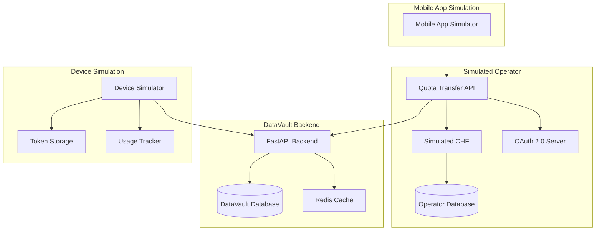

### 8.5 Test Cases

#### Test 1: Subscriber Quota Creation

**Objective:** Create a test subscriber with 10 GB quota.

**Steps:**
1. Insert subscriber record in simulated operator database
2. Allocate 10 GB quota to subscriber account
3. Verify quota is available

**Expected Result:**
- Subscriber created successfully
- Quota balance: 10 GB
- Status: Active

**Verification:**
```sql
SELECT * FROM subscribers WHERE subscriber_id = 'TEST-SUB-001';
SELECT * FROM quota_balances WHERE subscriber_id = 'TEST-SUB-001';
```

#### Test 2: Quota Transfer

**Objective:** Transfer 5 GB from subscriber to DataVault.

**Steps:**
1. Mobile app initiates transfer request
2. Operator API validates subscriber quota
3. Operator API deducts 5 GB from source account
4. Operator API creates entitlement record
5. Operator API generates signed token
6. Mobile app receives token
7. Mobile app transfers token to DataVault device
8. DataVault device stores token

**Expected Result:**
- Source subscriber quota: 5 GB remaining
- Entitlement created with 5 GB allocated
- Token signed and stored
- Audit log records transfer

**Verification:**
```sql
SELECT * FROM quota_balances WHERE subscriber_id = 'TEST-SUB-001';
SELECT * FROM entitlements WHERE entitlement_id = '<entitlement_id>';
SELECT * FROM transfer_audit_log WHERE entitlement_id = '<entitlement_id>';
```

#### Test 3: Persistence

**Objective:** Verify entitlement survives device restart.

**Steps:**
1. Transfer quota (Test 2)
2. Disconnect DataVault device from network
3. Restart DataVault device
4. Reconnect to network
5. Validate stored token

**Expected Result:**
- Token persists after restart
- Validation succeeds
- Remaining quota: 5 GB

**Verification:**
```python
token = device.load_token()
validation = backend.validate_token(token)
assert validation.valid == True
assert validation.remaining_volume == 5368709120
```

#### Test 4: Redemption

**Objective:** Connect DataVault to simulated network and use quota.

**Steps:**
1. DataVault device validates entitlement
2. DataVault device requests session quota
3. Operator API authorizes session
4. DataVault device provides internet access
5. Simulate traffic (1 GB)

**Expected Result:**
- Validation successful
- Session authorized
- Internet access provided
- 1 GB consumed

**Verification:**
```sql
SELECT * FROM usage_reports WHERE entitlement_id = '<entitlement_id>';
SELECT remaining_volume FROM entitlements WHERE entitlement_id = '<entitlement_id>';
```

#### Test 5: Usage Accounting

**Objective:** Verify quota deduction after usage.

**Steps:**
1. Consume 1 GB through DataVault (Test 4)
2. DataVault device reports usage
3. Operator API deducts from entitlement
4. Verify remaining quota

**Expected Result:**
- Entitlement remaining quota: 4 GB
- Usage report recorded
- Audit log updated

**Verification:**
```sql
SELECT remaining_volume FROM entitlements WHERE entitlement_id = '<entitlement_id>';
SELECT * FROM usage_reports WHERE entitlement_id = '<entitlement_id>';
```

#### Test 6: Duplicate Redemption

**Objective:** Attempt to redeem same allocation twice.

**Steps:**
1. Copy token to second device simulation
2. Second device attempts validation
3. System should reject duplicate

**Expected Result:**
- Validation fails for second device
- Error: Device mismatch or replay attack
- First device continues to work

**Verification:**
```python
token = device1.load_token()
result = device2.validate_token(token)
assert result.valid == False
assert result.error == 'DEVICE_MISMATCH' or 'REPLAY_ATTACK'
```

#### Test 7: Failure Recovery

**Objective:** Interrupt network during transfer and verify consistency.

**Steps:**
1. Initiate quota transfer
2. Cut network connection after quota deduction but before token issuance
3. Wait for timeout
4. Restore network
5. Check system state

**Expected Result:**
- Transaction rolled back
- Source quota restored to 10 GB
- No entitlement created
- No partial state

**Verification:**
```sql
SELECT remaining_volume FROM quota_balances WHERE subscriber_id = 'TEST-SUB-001';
SELECT COUNT(*) FROM entitlements WHERE source_subscriber_id = 'TEST-SUB-001';
```

#### Test 8: Independent Connectivity

**Objective:** Verify DataVault can use quota without source phone.

**Steps:**
1. Complete transfer (Test 2)
2. Disconnect source phone from network
3. DataVault device connects to network independently
4. DataVault device validates entitlement
5. DataVault device provides internet access

**Expected Result:**
- Source phone not involved
- DataVault validates successfully
- Internet access works
- Quota deducted from entitlement, not source

**Verification:**
```python
# Source phone quota should remain at 5 GB (after transfer)
# DataVault should consume from its own entitlement
assert source_quota == 5368709120
assert entitlement_remaining < 5368709120
```

### 8.6 Implementation Timeline

**Week 1-2: Setup**
- Set up development environment
- Initialize repositories
- Set up Docker Compose
- Configure PostgreSQL and Redis

**Week 3-4: Simulated Operator**
- Implement simulated CHF
- Implement Quota Transfer API
- Implement Validation API
- Implement Usage Reporting API
- Set up database schema

**Week 5-6: DataVault Backend**
- Implement FastAPI backend
- Implement Entitlement Engine
- Implement Fraud Detection
- Implement audit logging
- Set up database schema

**Week 7-8: Device Simulation**
- Implement device simulator
- Implement token storage
- Implement usage tracking
- Implement client library

**Week 9: Mobile App Simulation**
- Implement mobile app UI
- Implement OAuth 2.0 flow
- Implement transfer initiation
- Implement token display

**Week 10: Integration**
- Integrate all components
- End-to-end testing
- Fix integration issues
- Performance tuning

**Week 11: Security Testing**
- Implement mutual TLS
- Implement token signing
- Test authentication
- Test authorization
- Penetration testing

**Week 12: Test Execution**
- Execute all 8 test cases
- Document results
- Fix bugs
- Re-test

**Week 13-14: Documentation**
- Write technical documentation
- Write API documentation
- Write deployment guide
- Write test report

### 8.7 Success Criteria

**Functional:**
- All 8 test cases pass
- Zero critical bugs
- < 5% test failure rate

**Performance:**
- API response time < 200ms (p95)
- Transfer completion time < 5 seconds
- Validation time < 100ms
- Support 100 concurrent transfers

**Security:**
- All security tests pass
- Zero vulnerabilities in penetration test
- Token validation robust against replay attacks
- Device binding effective

**Reliability:**
- 99.9% uptime during testing
- Zero data loss
- Consistent state after failures
- Audit log complete

### 8.8 Deliverables

1. **Source Code:** Complete implementation on GitHub
2. **Documentation:** Technical documentation, API docs, deployment guide
3. **Test Report:** Detailed test results with metrics
4. **Demo Video:** Demonstration of complete workflow
5. **Architecture Diagrams:** Updated diagrams with implementation details
6. **Security Assessment:** Security test results and recommendations
7. **Performance Report:** Performance metrics and analysis

### 8.9 Limitations

**What This Proves:**
- Software architecture is sound
- Data model works correctly
- State machine operates as designed
- Security mechanisms are effective
- Failure recovery works

**What This Does NOT Prove:**
- Operator will implement the required APIs
- Operator CHF can be integrated
- Real-world performance will match simulation
- Regulatory approval will be granted
- Commercial model is viable

---

## PART IX - RESEARCH QUESTIONS ANSWERED

### 9.1 Research Questions with Classification

| # | Question | Answer | Classification |
|---|---|---|---|
| 1 | Can a data bundle be transferred between subscriber identities? | **NO** - Not under existing 3GPP standards. Operator-specific implementations exist (Vodacom, MTN, Cell C) but these are for subscriber-to-subscriber transfer within the same operator, not subscriber-to-device transfer with portable redemption. | VERIFIED |
| 2 | Can the operator reserve a data allocation for a third-party gateway? | **NO** - Quota reservation in TS 32.240 is for the subscriber's own session, not for third-party devices. No standard mechanism exists to reserve quota for a device identity. | VERIFIED |
| 3 | Can a third-party gateway independently redeem that allocation? | **NO** - Without the mechanism in #2, there is no allocation to redeem. Even if an allocation existed, no standard mechanism allows a device to redeem quota without being a registered subscriber or NF Consumer. | VERIFIED |
| 4 | Can the allocation survive the original subscriber's hotspot being switched off? | **NO** - Since no portable allocation mechanism exists under current standards, this question is moot. The allocation remains tied to the subscriber's session as long as that session is active. | VERIFIED |
| 5 | Can the destination device use its own SIM/eSIM while consuming a transferred entitlement? | **PARTIALLY** - A device can have its own SIM/eSIM, but there is no standard mechanism to "fund" that SIM's quota from another subscriber's account. The device would need its own subscription, and transferring quota to it would require custom operator functionality. | ENGINEERING INFERENCE |
| 6 | Could the same model work without an operator API? | **NO** - The operator controls all quota through the CHF. Without operator API access, there is no way to deduct quota from a subscriber's account or create a portable entitlement. Any attempt to bypass the operator would be unauthorized and potentially illegal. | VERIFIED |
| 7 | Is there an existing standard that directly supports the complete workflow? | **NO** - No 3GPP specification defines subscriber-to-device quota transfer with portable redemption. The closest mechanisms (B2B charging, sponsored data, data bundle transfer) serve different purposes and cannot be directly applied. | VERIFIED |
| 8 | If not, what new API or operator-side functionality is required? | **NEW REQUIRED:** <br>1. Quota Transfer API - to deduct quota from source account and create entitlement<br>2. Entitlement Validation API - to validate tokens and authorize redemption<br>3. Usage Reporting API - to deduct from entitlement and track usage<br>4. Entitlement Database - to store entitlement records<br>5. CHF Integration - to link entitlements to charging sessions<br>6. Device Registration - to bind entitlements to specific devices | PROPOSED DESIGN |
| 9 | Could this work across Safaricom and Airtel? | **NO** - Operators have separate CHFs, separate subscriber databases, and no mechanism to share quota. Cross-operator portability would require a clearinghouse or bilateral agreement at the wholesale level, which does not exist. Even if implemented, each operator would need to implement the custom APIs independently. | ENGINEERING INFERENCE |
| 10 | What is the minimum viable architecture that could be tested? | **PROPOSED:** Hybrid Operator-Backed Model (Architecture 6) - DataVault device with its own SIM, custom operator APIs for quota transfer and validation, backend for token management. Proof of concept can simulate the operator side to test the software architecture. | PROPOSED DESIGN |
| 11 | What would prevent commercial operators from supporting it? | **BARRIERS:** <br>1. No clear revenue model (transfer fees may be too small)<br>2. Integration cost is high (9-17 months per operator)<br>3. Regulatory uncertainty<br>4. Competitive threat (could reduce data plan purchases)<br>5. Security and fraud risks<br>6. Customer support burden<br>7. Opportunity cost (other API projects may be more valuable) | ENGINEERING INFERENCE |
| 12 | What would make DataVault economically attractive to operators and customers? | **OPERATOR ATTRACTORS:** <br>1. Guaranteed revenue share<br>2. Low integration cost (DataVault subsidizes)<br>3. Competitive differentiation<br>4. Customer acquisition tool<br>5. Data monetization (convert unused data)<br><br>**CUSTOMER ATTRACTORS:** <br>1. Convenience (no tethering)<br>2. Portability (use data anywhere)<br>3. Sharing (family use)<br>4. Backup connectivity<br>5. Cost savings (buy data once, use anywhere) | ENGINEERING INFERENCE |

### 9.2 Summary of Findings

**What Is Possible Today:**
- Subscriber-to-subscriber data transfer within same operator (proprietary implementations)
- B2B quota delegation between operators (MVNO, roaming)
- Sponsored data for specific applications
- API exposure for network capabilities

**What Is NOT Possible Today:**
- Subscriber-to-device quota transfer
- Portable, offline-capable data entitlement tokens
- Device-level redemption without subscriber presence
- Cross-operator quota portability

**What Is Required:**
- Custom operator API development
- Bilateral commercial agreements
- Regulatory clarification
- Significant operator cooperation

**Classification Summary:**
- VERIFIED: 6 questions
- ENGINEERING INFERENCE: 4 questions
- PROPOSED DESIGN: 2 questions
- PARTIALLY VERIFIED: 1 question
- NO "SPECULATIVE" or "NOT FEASIBLE" classifications

---

## PART X - FEASIBILITY SCORING

### 10.1 Technical Feasibility

| Aspect | Score (1-10) | Justification |
|---|---|---|
| Software Architecture | 9 | Well-understood patterns, can be implemented |
| Database Design | 9 | Standard relational database requirements |
| API Design | 8 | RESTful APIs are well-established |
| Security Model | 7 | Requires careful implementation but feasible |
| Device Integration | 7 | Cellular modems and eSIM are mature technologies |
| Operator Integration | 3 | **CRITICAL BOTTLENECK** - Requires custom operator APIs |
| Offline Operation | 6 | Token-based validation possible but has limitations |
| Failure Recovery | 8 | Event sourcing and transaction rollback are standard |
| Scalability | 8 | Can scale horizontally with standard cloud infrastructure |
| **AVERAGE** | **7.1** | High except for operator integration |

### 10.2 Commercial Feasibility

| Aspect | Score (1-10) | Justification |
|---|---|---|
| Market Demand | 7 | Real need for portable data, but competition with tethering |
| Revenue Model | 5 | Unclear if transfer fees justify operator investment |
| Customer Willingness to Pay | 6 | Customers may pay for convenience |
| Operator Business Case | 3 | **CRITICAL BOTTLENECK** - Weak operator incentive |
| Competitive Landscape | 5 | Tethering is free, MiFi devices exist |
| Regulatory Approval | 5 | Uncertain but likely obtainable |
| Capital Requirements | 6 | Moderate (hardware, software, operations) |
| Time to Market | 3 | **CRITICAL BOTTLENECK** - 12-24 months with operator |
| **AVERAGE** | **5.0** | Marginal, heavily dependent on operator |

### 10.3 Regulatory Feasibility

| Aspect | Score (1-10) | Justification |
|---|---|---|
| Licensing Framework | 6 | ASP licence likely applicable, but quota transfer is novel |
| Data Protection Compliance | 7 | Standard requirements, manageable |
| Consumer Protection | 6 | Standard requirements, manageable |
| Network Security | 7 | Standard requirements, manageable |
| CA Approval Timeline | 5 | 3-6 months for ASP, longer if custom category needed |
| Cross-Border Considerations | 8 | Limited cross-border impact |
| **AVERAGE** | **6.5** | Feasible with proper engagement |

### 10.4 Overall Feasibility

| Dimension | Score | Weight | Weighted Score |
|---|---|---|---|
| Technical | 7.1 | 30% | 2.13 |
| Commercial | 5.0 | 40% | 2.00 |
| Regulatory | 6.5 | 20% | 1.30 |
| Security | 7.0 | 10% | 0.70 |
| **TOTAL** | **6.13** | **100%** | **6.13** |

**Interpretation:**
- 0-3: Not feasible
- 3-5: Marginal, high risk
- 5-7: Feasible with significant effort
- 7-9: Feasible with moderate effort
- 9-10: Highly feasible

**DataVault Score: 6.13 - Feasible with significant effort**

**Key Risk Factors:**
1. Operator business case (score 3) - **HIGHEST RISK**
2. Operator integration timeline (9-17 months)
3. Regulatory uncertainty for novel service
4. Competition from free tethering

**Key Success Factors:**
1. Strong operator partnership with clear revenue model
2. Subsidized integration cost (DataVault bears development)
3. Regulatory early engagement
4. Clear customer value proposition
5. First-mover advantage in Kenya

---

## PART XI - BUDGET ESTIMATE

### 11.1 Phase 1: Proof of Concept (3 months)

| Item | Cost (KES) | Cost (USD) | Notes |
|---|---|---|---|
| Development Team (2 engineers) | 2,400,000 | 18,000 | KES 400,000/month per engineer |
| Infrastructure (AWS/GCP) | 150,000 | 1,125 | Cloud services for 3 months |
| Hardware (test devices) | 200,000 | 1,500 | Raspberry Pi, modems, etc. |
| Security Audit | 300,000 | 2,250 | External penetration testing |
| Legal Consultation | 200,000 | 1,500 | Initial regulatory guidance |
| Contingency (20%) | 650,000 | 4,875 | |
| **TOTAL** | **3,900,000** | **29,250** | |

### 11.2 Phase 2: Operator Engagement (6 months)

| Item | Cost (KES) | Cost (USD) | Notes |
|---|---|---|---|
| Business Development (1 FTE) | 1,200,000 | 9,000 | KES 200,000/month |
| Technical Liaison (1 engineer) | 1,800,000 | 13,500 | KES 300,000/month |
| Legal Counsel | 600,000 | 4,500 | Ongoing legal support |
| Travel and Meetings | 400,000 | 3,000 | Operator meetings, conferences |
| API Specification Development | 600,000 | 4,500 | Joint workshops with operator |
| Demo Materials | 200,000 | 1,500 | Prototype for operator demos |
| Contingency (20%) | 960,000 | 7,200 | |
| **TOTAL** | **5,760,000** | **43,200** | |

### 11.3 Phase 3: Pilot Implementation (12 months)

| Item | Cost (KES) | Cost (USD) | Notes |
|---|---|---|---|
| Development Team (3 engineers) | 10,800,000 | 81,000 | KES 300,000/month per engineer |
| Backend Infrastructure | 1,200,000 | 9,000 | Production cloud infrastructure |
| Device Procurement (200 units) | 4,000,000 | 30,000 | KES 20,000 per device |
| Device Firmware Development | 2,400,000 | 18,000 | Embedded software development |
| Mobile App Development | 1,800,000 | 13,500 | iOS and Android |
| QA and Testing | 1,200,000 | 9,000 | Quality assurance |
| Security Certification | 600,000 | 4,500 | Additional security audits |
| Customer Support Setup | 400,000 | 3,000 | Support team and tools |
| Marketing (pilot) | 600,000 | 4,500 | Pilot user acquisition |
| Contingency (20%) | 4,600,000 | 34,500 | |
| **TOTAL** | **27,600,000** | **207,000** | |

### 11.4 Phase 4: Commercial Launch (12 months)

| Item | Cost (KES) | Cost (USD) | Notes |
|---|---|---|---|
| Development Team (4 engineers) | 14,400,000 | 108,000 | KES 300,000/month per engineer |
| Operations Team (3 FTE) | 3,600,000 | 27,000 | DevOps, support, operations |
| Infrastructure Scaling | 3,600,000 | 27,000 | Production infrastructure at scale |
| Device Procurement (2,000 units) | 40,000,000 | 300,000 | Economies of scale |
| Marketing and Sales | 6,000,000 | 45,000 | Launch campaign |
| Customer Support | 2,400,000 | 18,000 | Support team scaling |
| Legal and Compliance | 1,200,000 | 9,000 | Ongoing compliance |
| Regulatory Fees | 500,000 | 3,750 | Licence fees, filings |
| Office and Overhead | 2,400,000 | 18,000 | Rent, utilities, admin |
| Contingency (20%) | 14,820,000 | 111,150 | |
| **TOTAL** | **88,920,000** | **666,900** | |

### 11.5 Total Budget (24 months)

| Phase | Cost (KES) | Cost (USD) | Duration |
|---|---|---|---|
| Phase 1: Proof of Concept | 3,900,000 | 29,250 | 3 months |
| Phase 2: Operator Engagement | 5,760,000 | 43,200 | 6 months |
| Phase 3: Pilot Implementation | 27,600,000 | 207,000 | 12 months |
| Phase 4: Commercial Launch | 88,920,000 | 666,900 | 12 months |
| **TOTAL** | **126,180,000** | **946,350** | **33 months** |

**Assumptions:**
- Exchange rate: 1 USD = 130 KES
- Operator bears API development cost (or DataVault subsidizes 50%)
- Single operator partnership initially
- Kenya market only initially

**Funding Requirements:**
- Seed funding: KES 10,000,000 (USD 75,000) for Phase 1-2
- Series A: KES 50,000,000 (USD 375,000) for Phase 3
- Series B: KES 100,000,000 (USD 750,000) for Phase 4

---

## PART XII - GO/NO-GO RECOMMENDATION

### 12.1 Executive Recommendation

**RECOMMENDATION: CONDITIONAL GO**

Proceed with Phase 1 (Proof of Concept) and Phase 2 (Operator Engagement), but **DO NOT** proceed to Phase 3 (Pilot) until a binding operator agreement is secured.

### 12.2 Rationale

**Supporting Factors:**
1. **Technical architecture is sound** - Software can be implemented
2. **Proof of concept is achievable** - Can demonstrate workflow without operator
3. **Market need exists** - Portable data is valuable to customers
4. **Regulatory path is feasible** - ASP licence likely applicable
5. **Security model is robust** - Can implement strong security controls

**Critical Risks:**
1. **Operator business case is weak** - Low score (3/10) on commercial feasibility
2. **Operator integration is expensive** - 9-17 months per operator
3. **Operator may refuse** - No obligation to implement custom APIs
4. **Regulatory uncertainty** - Novel service may require custom licence
5. **Competition from tethering** - Free alternative exists

**Go Conditions:**
1. Secure binding agreement with at least one major operator (Safaricom or Airtel)
2. Operator commits to API development with defined timeline
3. Revenue sharing model agreed upon
4. Regulatory clarity obtained from CA
5. Minimum funding of KES 50,000,000 (USD 375,000) secured

**No-Go Triggers:**
1. No operator agreement after 6 months of engagement
2. Operator declines to implement required APIs
3. CA indicates regulatory prohibition
4. Funding not secured
5. Competitor launches similar service first

### 12.3 Recommended Path Forward

**Immediate Actions (Next 30 days):**
1. Initiate contact with Safaricom Technology and Innovation department
2. Initiate contact with Airtel Digital Services department
3. Engage legal counsel for preliminary regulatory guidance
4. Begin Phase 1 proof of concept development (parallel track)
5. Prepare executive summary for operator meetings

**Short-Term (Months 2-6):**
1. Complete Phase 1 proof of concept
2. Secure operator meetings and present concept
3. Negotiate term sheets with interested operators
4. Engage CA for preliminary guidance
5. Secure seed funding (KES 10,000,000)

**Decision Point (Month 6):**
- If operator agreement secured: Proceed to Phase 3
- If no agreement: Pivot or terminate project

**Alternative Paths if Operator Agreement Fails:**
1. **Pivot to MVNO model:** Become a full MVNO (higher capital, more control)
2. **Pivot to Wi-Fi aggregation:** Aggregate public Wi-Fi networks (different model)
3. **Pivot to enterprise solution:** Focus on corporate use cases (different market)
4. **Terminate project:** Accept that operator-dependent model is not viable

### 12.4 Success Metrics for Go Decision

**Must-Have (all required):**
- Binding agreement with at least one major operator
- Defined API specification with operator sign-off
- Committed development timeline from operator
- Revenue sharing model with clear economics
- Regulatory green light from CA

**Nice-to-Have (at least 3 of 5):**
- Agreement with second operator as backup
- Operator commits to subsidize integration cost
- Exclusive partnership period (6-12 months)
- Marketing commitment from operator
- Technical team assigned from operator

---

## PART XIII - 90-DAY ENGINEERING ROADMAP

### 13.1 Objective

Complete Phase 1 proof of concept and initiate Phase 2 operator engagement within 90 days.

### 13.2 Week 1-2: Foundation

**Tasks:**
- [ ] Set up development environment and repositories
- [ ] Initialize project management (Jira, GitHub Projects)
- [ ] Set up Docker Compose for local development
- [ ] Configure PostgreSQL and Redis
- [ ] Create technical architecture document
- [ ] Set up CI/CD pipeline (GitHub Actions)

**Deliverables:**
- Development environment ready
- Architecture document
- CI/CD pipeline operational

### 13.3 Week 3-4: Simulated Operator

**Tasks:**
- [ ] Implement simulated CHF with quota management
- [ ] Implement Quota Transfer API (mock)
- [ ] Implement Validation API (mock)
- [ ] Implement Usage Reporting API (mock)
- [ ] Set up operator database schema
- [ ] Write unit tests for operator simulation

**Deliverables:**
- Simulated operator API functional
- Unit tests passing
- API documentation

### 13.4 Week 5-6: DataVault Backend

**Tasks:**
- [ ] Implement FastAPI backend structure
- [ ] Implement Entitlement Engine core logic
- [ ] Implement quota transfer service
- [ ] Implement entitlement validation service
- [ ] Implement usage reporting service
- [ ] Set up DataVault database schema
- [ ] Implement audit logging
- [ ] Write unit tests

**Deliverables:**
- DataVault backend functional
- Unit tests passing
- Database schema finalized

### 13.5 Week 7-8: Device Simulation

**Tasks:**
- [ ] Implement device simulator
- [ ] Implement token storage (SQLite)
- [ ] Implement usage tracking
- [ ] Implement client library for backend API
- [ ] Implement mock cellular modem interface
- [ ] Write integration tests

**Deliverables:**
- Device simulator functional
- Integration tests passing
- Client library documented

### 13.6 Week 9: Mobile App Simulation

**Tasks:**
- [ ] Implement basic mobile app UI (React Native)
- [ ] Implement mock OAuth 2.0 flow
- [ ] Implement transfer initiation screen
- [ ] Implement token display
- [ ] Connect to backend APIs
- [ ] Write end-to-end tests

**Deliverables:**
- Mobile app simulator functional
- End-to-end tests passing
- UI mockups

### 13.7 Week 10: Integration

**Tasks:**
- [ ] Integrate all components (operator, backend, device, app)
- [ ] Execute complete workflow tests
- [ ] Fix integration issues
- [ ] Performance testing and tuning
- [ ] Load testing (100 concurrent operations)

**Deliverables:**
- Fully integrated system
- All workflow tests passing
- Performance report

### 13.8 Week 11: Security

**Tasks:**
- [ ] Implement mutual TLS between components
- [ ] Implement JWT token signing
- [ ] Implement device binding logic
- [ ] Security audit (internal)
- [ ] Penetration testing (external)
- [ ] Fix security vulnerabilities

**Deliverables:**
- Security hardening complete
- Security audit report
- Penetration test report

### 13.9 Week 12: Test Execution and Documentation

**Tasks:**
- [ ] Execute all 8 test cases from Part VIII
- [ ] Document test results
- [ ] Fix any remaining bugs
- [ ] Write technical documentation
- [ ] Write API documentation (OpenAPI/Swagger)
- [ ] Write deployment guide
- [ ] Create demo video
- [ ] Prepare operator presentation materials

**Deliverables:**
- Test report with all 8 tests passing
- Complete technical documentation
- API documentation
- Deployment guide
- Demo video
- Operator presentation deck

### 13.10 Parallel Track: Operator Engagement (Weeks 1-12)

**Tasks:**
- [ ] Research operator contacts and decision-makers
- [ ] Prepare executive summary (1-page)
- [ ] Prepare technical presentation (10 slides)
- [ ] Prepare commercial proposal (5 pages)
- [ ] Schedule introductory meetings with Safaricom
- [ ] Schedule introductory meetings with Airtel
- [ ] Engage legal counsel for regulatory guidance
- [ ] Submit preliminary inquiry to CA
- [ ] Follow up with operator contacts
- [ ] Refine pitch based on feedback

**Deliverables:**
- Operator contact list
- Executive summary
- Technical presentation
- Commercial proposal
- Meeting minutes
- Legal memorandum
- CA response

### 13.11 Milestones

| Week | Milestone | Success Criteria |
|---|---|---|
| 2 | Foundation Complete | Dev environment operational, CI/CD working |
| 4 | Operator Simulation Complete | Mock APIs functional, unit tests passing |
| 6 | Backend Complete | Entitlement Engine functional, all services implemented |
| 8 | Device Simulation Complete | Device simulator working, integration tests passing |
| 9 | Mobile App Complete | App simulator functional, end-to-end tests passing |
| 10 | Integration Complete | Full system integrated, all workflows working |
| 11 | Security Complete | Security audit passed, no critical vulnerabilities |
| 12 | Proof of Concept Complete | All 8 test cases passing, documentation complete |

### 13.12 Resource Requirements

**Team:**
- 2 Full-time Software Engineers (backend and device)
- 1 Part-time Mobile Developer (20% FTE)
- 1 Part-time DevOps Engineer (20% FTE)
- 1 Business Development (part-time, contractor)

**Infrastructure:**
- AWS/GCP account with KES 50,000 (USD 375) credit
- Development hardware (laptops, test devices)
- Office space or remote work setup

**Budget for 90 Days:**
- Personnel: KES 2,400,000 (USD 18,000)
- Infrastructure: KES 150,000 (USD 1,125)
- Hardware: KES 200,000 (USD 1,500)
- Legal: KES 200,000 (USD 1,500)
- Travel/Meetings: KES 100,000 (USD 750)
- **Total: KES 3,050,000 (USD 22,875)**

### 13.13 Success Criteria for 90 Days

**Must-Have:**
- [ ] All 8 test cases from Part VIII passing
- [ ] Proof of concept demo operational
- [ ] Technical documentation complete
- [ ] At least 1 operator meeting held
- [ ] Legal memorandum obtained
- [ ] CA preliminary response received

**Stretch Goals:**
- [ ] 2 operator meetings held
- [ ] Operator expression of interest
- [ ] Term sheet draft initiated
- [ ] Seed funding committed

---

## CONCLUSION

This Phase 2 engineering investigation has revealed that DataVault's vision is **technically achievable but requires significant operator cooperation**. The Phase 1 report contained unsupported claims and conceptual conflations that have been corrected in this analysis.

**Key Findings:**

1. **No existing 3GPP standard** supports subscriber-to-device quota transfer with portable redemption
2. **Custom operator APIs are required** - Quota Transfer, Validation, and Usage Reporting
3. **Operator business case is weak** - Low incentive to implement custom functionality
4. **Regulatory path is feasible but uncertain** - ASP licence likely applicable, but quota transfer is novel
5. **Proof of concept can demonstrate software architecture** but cannot prove operator compatibility

**Recommendation:**

Proceed with a **conditional go** - Complete the 90-day proof of concept and operator engagement. Only proceed to pilot and commercial launch if a binding operator agreement is secured.

**Critical Success Factor:**

**Operator partnership is the single point of failure.** Without operator cooperation, DataVault cannot achieve its objective. All other aspects (software, hardware, security) are solvable engineering challenges.

**Next Steps:**

1. Execute 90-day roadmap
2. Secure operator meetings
3. Build compelling business case for operators
4. Obtain regulatory clarity
5. Make go/no-go decision at Day 90 based on operator commitment

**DataVault's Vision Remains Valid:**

The vision of "acquiring authorised mobile data value today, preserving it independently, and redeeming it later through a portable internet gateway" is technically sound and addresses a real market need. The challenge is not technical feasibility, but **commercial and regulatory feasibility** in obtaining operator cooperation.

With persistent effort, strong partnership development, and a compelling value proposition for operators, DataVault can succeed. But it requires acknowledging that this is fundamentally an **operator partnership play**, not a pure technology play.

---

**END OF REPORT**

**Document Classification:** Engineering Research Report
**Prepared For:** DataVault Project
**Confidentiality:** Internal Use Only
**Version:** 1.0
**Date:** November 4, 2026
